# Java vs. MongoDB

Shipping Java agents to MongoDB Atlas Agent Engine

<div class="title-meta">
<p class="speaker"><a href="https://jgalego.github.io">João Galego</a> $$\left|\text{🧠}\right>$$ </p>
<p class="small">MongoDB × Java meetup · November 2026</p>
</div>

Note: 0:00. Thirty minutes in the redux (R). One sentence: "This is the story of getting Java onto a platform that only speaks Python and TypeScript."

---

<!-- .slide: data-skippable="true" -->
# $ whoami

--

## From atoms to agents

<div style="display: flex; gap: 2em; justify-content: center; align-items: flex-start; font-size: 0.8em; margin-top: 1.6em">
<div style="flex: 1"><h4 style="margin: 0 0 0.8em">Education</h4><p style="margin: 0.9em 0 0.2em">MSc Physics</p><p style="margin: 0"></p><p style="margin: 0.9em 0 0.2em">PgDip Forensics</p><p style="margin: 0"></p><p style="margin: 0.9em 0 0.2em">PhD Cognitive Science (ABD)</p><p style="margin: 0"></p></div>
<div style="flex: 1"><h4 style="margin: 0 0 0.8em">Work</h4><p style="margin: 0.9em 0 0.2em">Lead ML Engineer</p><p style="margin: 0"></p><p style="margin: 0.9em 0 0.2em">Solutions Architect</p><p style="margin: 0"></p><p style="margin: 0.9em 0 0.2em">Head of AI</p><p style="margin: 0"></p></div>
</div>

Note: 0:30. The whole whoami is about a minute and a half. Keep it quick. The PhD is ABD; I once performed an autopsy (the forensics diploma), which gets a laugh.

--

## At , we build systems <br>that can't fail

<p style="font-size: 0.6em; margin: 1.8em 0 0; white-space: nowrap">🚀 Space · ✈️ Aviation · 🚆 Railway · 🏥 Medical devices · 🚗 Automotive · 🛡️ Defence · ⚡ Energy</p>

<p class="small">Since 1998 · NASA · ESA · Airbus · BMW · Alstom</p>

Note: Critical Software, from the company's own site (criticalsoftware.com): the sectors, the year (since 1998) and the client names. This is also where the Near Miss demo comes from: reports where "it mostly works" is not enough.

--

<!-- .slide: data-skippable="true" -->
## Tenets to live by

<div style="display: flex; gap: 1.2em; align-items: center">
<a href="https://amazon.jobs/content/en/teams/principal-engineering/tenets" target="_blank" rel="noopener" style="flex: 1.3; min-width: 0">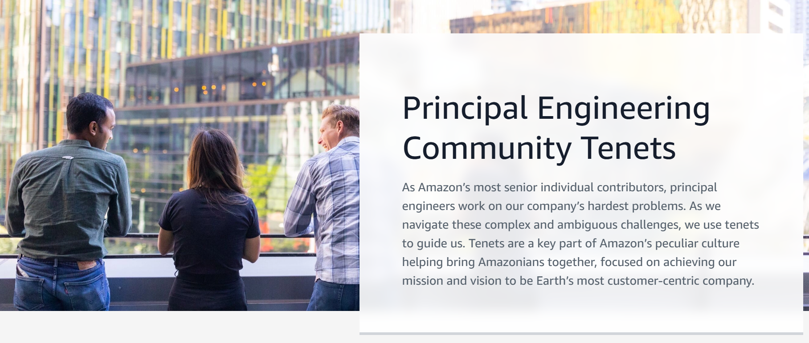</a>
<ol style="flex: 1; margin: 0; font-size: 0.62em; text-align: left; line-height: 1.55"><li>Exemplary practitioner</li><li>Technically fearless</li><li>Lead with empathy</li><li>Balanced and pragmatic</li><li>Illuminate and clarify</li><li>Flexible in approach</li><li>Respect what came before</li><li>Learn, educate, and advocate</li><li>Have resounding impact</li><li class="fragment tenet-bonus" style="color: var(--accent); font-weight: 700">Have fun doing it</li></ol>
</div>

Note: Amazon's Principal Engineering Community tenets, nine of them on the public page (amazon.jobs/en/landing_pages/pe-community-tenets). Click once more for number ten: it pops in. Number ten is mine, taken from the line in the old bio: dropped out to live life and have fun doing it.

--

<!-- .slide: data-skippable="true" -->
## TL;DR

Break things at scale

Build things faster

Make brains<span style="color: var(--accent)">*</span> go brrr

<small>

<span style="color: var(--accent)">* **all** brain types welcome!</span>

</small>

--

## Want to know what I'm up to?

<div style="display: flex; gap: 1.2em; align-items: center; justify-content: center">
<div style="flex: 1.7; min-width: 0; font-size: 0.8em">

```text
$ finger jgalego@plan.cat
Head of AI @ Critical Software.
Invited Professor @ ISEG/ULisboa.

Now:
  * bringing ML to places where "it mostly
    works" isn't enough
  * teaching (but mostly, learning)

Todo:
  - update this .plan more often
    than once a decade

Elsewhere:
  web       https://jgalego.github.io
  code      https://github.com/JGalego
  linkedin  .../in/jgalego  (fastest HELO)
```

</div>
<div style="flex: 1; text-align: center">
<a href="https://www.linkedin.com/in/jgalego/"></a>
<div style="background: #fff; padding: 10px; border-radius: 10px; width: 210px; margin: 0.4em auto 0"></div>
<p class="small" style="margin: 0.3em 0 0"><a href="https://en.wikipedia.org/wiki/Finger_(protocol)">finger</a> me or just scan.</p>
</div>
</div>

Note: The finger output is real: the server at plan.cat answers on port 79. Carrier pigeons accepted per RFC 1149.

---

<!-- .slide: class="disney" data-background-gradient="radial-gradient(ellipse at 50% 0%, #2B4C9B 0%, #10204A 55%, #060B1F 100%)" -->
<div class="sparkles" aria-hidden="true"><i></i><i></i><i></i><i></i><i></i><i></i><i></i><i></i><i></i><i></i><i></i><i></i></div>

<p class="disney-title">Once upon a time…</p>

<div class="acts">
<div class="act fragment"><span class="act-icon">🏰</span><strong>The kingdom</strong><small>A Java agent dreams of Atlas</small></div>
<div class="act fragment"><span class="act-icon">🐉</span><strong>The curse</strong><small>A dragon named <code>java-none</code></small></div>
<div class="act fragment"><span class="act-icon">🗺️</span><strong>The quest</strong><small>Smuggle Java past the dragon</small></div>
<div class="act fragment"><span class="act-icon">✨</span><strong>Happily ever after</strong><small>Java answers from Atlas</small></div>
</div>

<p class="dedication">Dedicated to João Mourão, who asked for a Disney movie</p>

Note: The structure of the talk, told the way João Mourão (MongoDB SA) suggested: context, the problem, the journey, the resolution. Click once per act. Credit him by name: the reorder was his idea. Not affiliated with Disney; the sparkles are CSS.

---

<!-- .slide: data-background-color="var(--divider)" -->
## <span class="divider-title"><span class="chapter">Prologue</span>Once upon a time</span>

Note: 2:00. The prologue, about 4 minutes. What we're building and what it looks like when it works, before any of the pain.

--

### What's a near miss?

<p class="big">near miss</p>

<p class="fragment" style="font-size: 1.1em"><em>noun</em> · an incident that nearly became an accident</p>

<div class="flow auto">
<span style="--i:0"><span class="pill bad">⚠️ Close call</span></span><span style="--i:1"><span class="arrow">→</span><span class="pill">📝 Someone reports it</span></span><span style="--i:2"><span class="arrow">→</span><span class="pill good">🔎 An agent finds it</span></span>
</div>

Note: An aviation term, and the name of the demo. Real public safety reports, searched by an agent. High stakes on purpose: it forces the agent to be careful about what it claims.

--

### Where the reports come from

<svg viewBox="0 0 1000 410" role="img" aria-label="Three public sources, FDA MAUDE, NHTSA and NASA ASRS, are embedded by MiniLM in Java and stored in one Atlas Vector Search index" style="width:100%;max-height:520px">
<defs><marker id="wa" viewBox="0 0 10 10" refX="9" refY="5" markerWidth="6" markerHeight="6" orient="auto"><path d="M0 0L10 5L0 10z" fill="var(--accent)"/></marker></defs>
<rect x="20" y="30" width="290" height="100" rx="12" fill="var(--accent-soft)" stroke="var(--accent)" stroke-width="2"/><text x="62" y="92" text-anchor="middle" font-weight="400" fill="var(--heading)" font-size="38">🏥</text><text x="104" y="68" text-anchor="start" font-weight="700" fill="var(--heading)" font-size="20">FDA MAUDE</text><text x="104" y="92" text-anchor="start" font-weight="400" fill="var(--heading)" font-size="15">medical device reports</text><text x="104" y="114" text-anchor="start" font-weight="500" fill="var(--muted)" font-size="14" font-family="var(--r-code-font)">openFDA API</text><rect x="20" y="160" width="290" height="100" rx="12" fill="var(--accent-soft)" stroke="var(--accent)" stroke-width="2"/><text x="62" y="222" text-anchor="middle" font-weight="400" fill="var(--heading)" font-size="38">🚗</text><text x="104" y="198" text-anchor="start" font-weight="700" fill="var(--heading)" font-size="20">NHTSA</text><text x="104" y="222" text-anchor="start" font-weight="400" fill="var(--heading)" font-size="15">vehicle complaints</text><text x="104" y="244" text-anchor="start" font-weight="500" fill="var(--muted)" font-size="14" font-family="var(--r-code-font)">complaints API</text><rect x="20" y="290" width="290" height="100" rx="12" fill="var(--accent-soft)" stroke="var(--accent)" stroke-width="2"/><text x="62" y="352" text-anchor="middle" font-weight="400" fill="var(--heading)" font-size="38">✈️</text><text x="104" y="328" text-anchor="start" font-weight="700" fill="var(--heading)" font-size="20">NASA ASRS</text><text x="104" y="352" text-anchor="start" font-weight="400" fill="var(--heading)" font-size="15">aviation safety reports</text><text x="104" y="374" text-anchor="start" font-weight="500" fill="var(--muted)" font-size="14" font-family="var(--r-code-font)">report-set PDFs</text>
<g class="fragment"><path d="M312 80 C 370 80, 360 185, 416 185" stroke="var(--accent)" stroke-width="3" fill="none" marker-end="url(#wa)"/><path d="M312 210 L 416 210" stroke="var(--accent)" stroke-width="3" fill="none" marker-end="url(#wa)"/><path d="M312 340 C 370 340, 360 235, 416 235" stroke="var(--accent)" stroke-width="3" fill="none" marker-end="url(#wa)"/><text x="364" y="200" text-anchor="middle" font-weight="600" fill="var(--accent)" font-size="15">text</text><rect x="420" y="135" width="230" height="150" rx="14" fill="var(--accent-soft)" stroke="var(--accent)" stroke-width="2"/><path transform="translate(467 152) scale(1.167)" fill="var(--heading)" d="M1.4446 11.5059c0 1.1021.1673 2.1585.4847 3.1563-.0378-.0028-.0691-.0058-.1058-.0058-.4209 0-.8015.16-1.0704.4512-.3454.3737-.4984.8335-.4316 1.293a1.576 1.576 0 0 0 .2148.5978c-.2319.1864-.4018.4456-.4844.7578-.0646.2448-.131.7543.2149 1.2794a1.4552 1.4552 0 0 0-.0625.1055c-.208.3923-.2207.8372-.0371 1.25.2783.6258.9696 1.1175 2.3126 1.6467.8356.3292 1.5988.5411 1.6056.543 1.1046.2847 2.104.4277 2.969.4277 1.4173 0 2.4754-.3849 3.1525-1.1446 1.538.2651 2.791.1403 3.592.006.6773.7555 1.7332 1.1387 3.1467 1.1387.8649 0 1.8643-.143 2.969-.4278.0068-.0019.77-.2138 1.6056-.543 1.343-.5292 2.0343-1.0208 2.3126-1.6466.1836-.4129.171-.8577-.037-1.25a1.4685 1.4685 0 0 0-.0626-.1056c.346-.525.2795-1.0346.2149-1.2793-.0826-.3122-.2525-.5714-.4844-.7579.11-.1816.1831-.3788.2148-.5977.0669-.4595-.0862-.9193-.4316-1.293-.2688-.2913-.6495-.4513-1.0704-.4513-.0209 0-.0376.0008-.0588.0018.3162-.9966.4846-2.0518.4846-3.1523 0-5.807-4.7362-10.5144-10.5789-10.5144-5.8426 0-10.5788 4.7073-10.5788 10.5144Zm10.5788-9.4831c5.2727 0 9.5476 4.246 9.5476 9.483a9.4201 9.4201 0 0 1-.2696 2.2365c-.0039-.0047-.0079-.011-.0117-.0156-.274-.3255-.6679-.5059-1.1075-.5059-.352 0-.714.1155-1.0763.3438-.2403.1517-.5058.422-.7793.7598-.2534-.3492-.608-.5832-1.0137-.6465a1.5174 1.5174 0 0 0-.2344-.0176c-.9263 0-1.4828.7993-1.6935 1.5177-.1046.2426-.6065 1.3482-1.3614 2.0978-1.1681 1.1601-1.4458 2.3534-.8396 3.6382-.843.1029-1.5836.0927-2.365-.006.5906-1.212.3626-2.4388-.8426-3.6322-.755-.7496-1.2568-1.8552-1.3614-2.0978-.2107-.7184-.7673-1.5177-1.6935-1.5177-.078 0-.1568.0054-.2344.0176-.4057.0633-.7604.2973-1.0137.6465-.2735-.3379-.539-.6081-.7794-.7598-.3622-.2283-.7243-.3438-1.0762-.3438-.4266 0-.8094.171-1.0821.4786a9.4208 9.4208 0 0 1-.2598-2.1936c0-5.237 4.2749-9.483 9.5475-9.483zM8.6443 7.0036c-.4838.0043-.9503.2667-1.1934.7227-.3536.6633-.1006 1.4873.5645 1.84.351.1862.4883-.5261.836-.6485.3107-.1095.841.399 1.0078.086.3536-.6634.1025-1.4874-.5625-1.84a1.3659 1.3659 0 0 0-.6524-.1602Zm6.8403 0c-.2199-.002-.4426.05-.6504.1602-.665.3526-.9181 1.1766-.5645 1.84.1669.313.6971-.1955 1.0079-.086.3476.1224.4867.8347.838.6485.6649-.3527.916-1.1767.5624-1.84-.243-.456-.7096-.7184-1.1934-.7227Zm-9.7565 1.418a.8768.8768 0 0 0-.877.877c0 .4846.3925.877.877.877a.8768.8768 0 0 0 .877-.877.8768.8768 0 0 0-.877-.877zm12.6434 0c-.4845 0-.879.3925-.879.877 0 .4846.3945.877.879.877a.8768.8768 0 0 0 .877-.877.8768.8768 0 0 0-.877-.877zM8.7927 11.459c-.179-.003-.2793.1107-.2793.416 0 .8097.3874 2.125 1.4279 2.924.207-.7123 1.3453-1.2832 1.5079-1.2012.2315.1167.2191.4417.6074.7266.3884-.285.374-.6098.6056-.7266.1627-.082 1.3009.4889 1.5079 1.2012 1.0404-.799 1.4278-2.1144 1.4278-2.924 0-1.2212-1.583.6402-3.5413.6485-1.4686-.0061-2.7266-1.0558-3.2639-1.0645zM4.312 14.4768c.5792.365 1.6964 2.2751 2.1056 3.0177.1371.2488.371.3536.582.3536.4188 0 .7465-.4138.0391-.9395-1.0636-.791-.6914-2.0846-.1836-2.1642a.4302.4302 0 0 1 .0664-.004c.4616 0 .666.7892.666.7892s.5959 1.4898 1.6213 2.508c.942.9356 1.062 1.703.4961 2.6661-.0164-.004-.0159.0236-.1484.2149-.1853.2673-.4322.4688-.7188.6152-.5062.2269-1.1397.2696-1.7833.2696-1.037 0-2.1017-.1824-2.6975-.336-.0293-.0075-3.6505-.9567-3.1916-1.8224.0771-.1454.2033-.2031.3633-.2031.6463 0 1.823.9551 2.3283.9551.113 0 .196-.0865.2285-.2031.2249-.8045-3.2787-1.0522-2.9846-2.1642.0519-.1967.193-.2757.3907-.2754.854 0 2.7704 1.4923 3.172 1.4923.0307 0 .0525-.0085.0645-.0274.2012-.3227.1096-.5865-1.3087-1.4395-1.4182-.8533-2.4315-1.329-1.8653-1.9416.0651-.0707.1574-.1015.2695-.1015.8611.0002 2.8948 1.84 2.8948 1.84s.5487.5683.8809.5683c.0762 0 .1416-.0315.1855-.1054.2355-.3946-2.1858-2.2183-2.3224-2.971-.0926-.51.0641-.7676.3555-.7676-.0006.008.1701-.0285.4942.1759zm16.2257.5918c-.1366.7526-2.5579 2.5764-2.3224 2.9709.044.074.1092.1055.1855.1055.3321 0 .881-.5684.881-.5684s2.0336-1.8397 2.8947-1.84c.1121 0 .2044.0308.2695.1016.5662.6125-.447 1.0882-1.8653 1.9415-1.4183.853-1.51 1.1168-1.3087 1.4396.012.0188.0337.0273.0644.0273.4016 0 2.3181-1.4923 3.1721-1.4923.1977-.0002.3388.0787.3907.2754.294 1.112-3.2095 1.3597-2.9846 2.1642.0325.1166.1156.2032.2285.2032.5054 0 1.682-.9552 2.3283-.9552.16 0 .2862.0577.3633.2032.459.8656-3.1623 1.8149-3.1916 1.8224-.5958.1535-1.6605.336-2.6975.336-.6351 0-1.261-.0409-1.7638-.2599-.2949-.1472-.5488-.3516-.7383-.625-.0411-.0682-.1026-.1476-.1426-.205-.5726-.9679-.455-1.7371.4903-2.676 1.0254-1.0182 1.6212-2.508 1.6212-2.508s.2044-.7891.666-.7891a.4318.4318 0 0 1 .0665.0039c.5078.0796.88 1.3732-.1836 2.1642-.7074.5257-.3797.9395.039.9395.211 0 .445-.1047.5821-.3535.4092-.7426 1.5264-2.6527 2.1056-3.0178.5588-.3524.99-.1816.8497.5918z"/><path transform="translate(521 152) scale(1.167)" fill="var(--heading)" d="M23.0325 11.2963c-.0503 0-.1006 0-.1508.0126l-4.021-7.4387c.0754-.1383.1131-.289.1131-.4524 0-.5403-.4398-.9675-.9675-.9675-.2765 0-.5278.113-.7037.3015L9.286 1.156C9.2357.6785 8.821.3016 8.3184.3016c-.5277 0-.9675.4398-.9675.9675 0 .1634.0377.3141.113.4524l-6.245 8.9591c-.0753-.0251-.1633-.0377-.2513-.0377-.5403 0-.9675.4398-.9675.9676 0 .5403.4398.9675.9675.9675h.0377l3.3676 8.3309c-.0503.1257-.088.2639-.088.402 0 .5404.4398.9676.9676.9676.2764 0 .5277-.113.7036-.3015l10.1152.9926c.1005.4273.49.7288.9424.7288.5403 0 .9676-.4398.9676-.9675 0-.2388-.088-.465-.2262-.6283l5.1141-8.8712c.0503.0126.1005.0126.1634.0126.5403 0 .9675-.4398.9675-.9676 0-.5403-.4272-.98-.9675-.98zM17.2272 4.021c.1131.1508.2765.264.4524.3267l-1.533 11.5728c-.1005.0252-.1885.0503-.2764.1005L7.4513 8.708c.0251-.0754.0377-.1634.0377-.2514 0-.0628-.0126-.1256-.0126-.1884zm4.8754 8.5068l-5.177 3.556a1.105 1.105 0 0 0-.1256-.0753L18.3455 4.335h.0126l3.9456 7.288c-.1508.1759-.2388.3895-.2388.6408 0 .1005.0126.1885.0377.2638zM6.3832 7.5016c-.4649.0754-.8293.4775-.8293.955v.0628l-3.4555 2.0481 5.378-7.7026zm.3519 1.91c.1256-.0252.2513-.088.3518-.1634l8.356 7.2628c-.0377.113-.0628.2262-.0628.3518v.0503l-9.311 3.845c-.1382-.201-.3518-.3518-.6031-.402zm8.8963 8.1172c.1257.1382.3016.2513.5026.289l.465 4.046c-.201.1006-.3519.264-.4524.4524l-9.8136-.955zm1.1435.2136c.3267-.1633.5403-.49.5403-.867 0-.088-.0126-.1634-.0377-.2513l4.7372-3.2545-4.8 8.331zm.2513-14.3497l-9.889 4.31-.1131-.0755 1.2565-5.3906h.0377c.3393 0 .6409-.1759.8168-.4397l7.891 1.5706zM1.935 11.6105c0-.0629-.0126-.1257-.0126-.1885l3.9079-2.2995c.0754.0754.1633.1508.2638.201L4.8252 20.243l-3.2043-7.9036c.1885-.176.3142-.4398.3142-.7288Z"/><image href="img/java.svg" x="575" y="150" width="23" height="32"/><text x="535" y="222" text-anchor="middle" font-weight="700" fill="var(--heading)" font-size="22">MiniLM</text><text x="535" y="248" text-anchor="middle" font-weight="400" fill="var(--heading)" font-size="15">embeds the text</text><text x="535" y="268" text-anchor="middle" font-weight="400" fill="var(--heading)" font-size="15">in Java</text></g>
<g class="fragment"><path d="M652 210 L 748 210" stroke="var(--accent)" stroke-width="3" fill="none" marker-end="url(#wa)"/><text x="700" y="198" text-anchor="middle" font-weight="600" fill="var(--accent)" font-size="15">vectors</text><rect x="752" y="135" width="230" height="150" rx="14" fill="var(--accent)" stroke="var(--accent)" stroke-width="2"/><image href="img/mongodb-icon.svg" x="855" y="148" width="20" height="42"/><text x="867" y="225" text-anchor="middle" font-weight="700" fill="#fff" font-size="22">Atlas</text><text x="867" y="250" text-anchor="middle" font-weight="700" fill="#fff" font-size="18">Vector Search</text><text x="867" y="272" text-anchor="middle" font-weight="400" fill="#fff" font-size="14">one index to rule them all</text></g>
</svg>

Note: Device adverse events, vehicle complaints and aviation safety reports, from three agencies. One local embedding model, MiniLM, running through ONNX inside the JVM, and one Atlas vector index. Each record is stored with its provenance and licence. The agent has three tools: semantic search, metadata filter and evidence correlation.

--

### Look ma, no console

<p class="filename">📄 AtlasVectorStore.java</p>

```java
var definition = new Document("fields", List.of(
    new Document("type", "vector").append("path", "embedding")
        .append("numDimensions", dims)  // 384 MiniLM, 1024 Voyage
        .append("similarity", "cosine"),
    new Document("type", "filter").append("path", "kind"),
    new Document("type", "filter").append("path", "dataset_id")));

collection.createSearchIndexes(List.of(new SearchIndexModel(
    "near_miss", definition, SearchIndexType.vectorSearch())));
```

<div class="fragment">

```java
vectorSearch(fieldPath("embedding"), query, "near_miss", limit,
    approximateVectorSearchOptions(candidates)
        .filter(eq("dataset_id", "nasa-asrs")))
```

</div>

<p class="fragment" style="font-size: 1.1em">Clicks don't survive a <code>git clone</code>.</p>

Note: The whole Atlas Vector Search setup, trimmed from AtlasVectorStore.java. One vector field with cosine similarity, plus two filter fields so a search can be limited to one kind or one dataset. Ingest calls this if the index is missing, then waits for it to be READY. Click for the query side: the $vectorSearch stage from the Java driver's builders, with the filter on dataset_id. candidates is ten times the limit, at least 40. If the index isn't READY, the store falls back to an exact cosine scan and says so in the result, it never pretends.

--

### Search by meaning

<div class="chat">
<div class="bubble client l fragment fade-up">🧑 "engine lost power during climb"</div>
</div>

<div class="fragment">

```text
0.533  M-4, Takeoff / Launch. Pilot flying Maule M4 aircraft
       reported engine loss of power inflight…

0.479  B737-700, Climb. Air carrier Captain reported an engine
       failure during climb…

0.42   Aeronca Champion, Commuter and GA Icing Incidents…
```

</div>

<p class="fragment" style="font-size: 1.1em">Different words, same meaning.</p>

Note: Real output, in memory, no Atlas needed. The three ASRS reports come from three different report sets, and none of them says "lost power during climb" in those words.

--

<!-- .slide: data-skippable="true" -->
### Same index, other agencies

```text
> insulin pump delivered too much insulin

0.659  INSULIN PUMP, Injury
       IT WAS REPORTED THAT CARTRIDGE CHANGE ERRORS OCCURRED
       WITH MULTIPLE CARTRIDGES DURING THE LOAD SEQUENCE…
```

<p class="fragment" style="font-size: 1.1em">One box for pumps and planes.</p>

Note: Real result from the in-memory run: a MAUDE report for the pump. The pump and the aeroplane came out of the same index, with one embedding model.

--

### Spoiler: the happy ending

<p style="font-size: 0.55em; margin: 0 0 0.4em"><em>"The Road goes ever on and on / Down from the door where it began."</em> <span class="small">— J.R.R. Tolkien, <em>The Fellowship of the Ring</em></span></p>

<div style="display: flex; gap: 0.8em; align-items: center; width: 960px; position: relative; left: 50%; transform: translateX(-50%)">
<svg viewBox="0 0 1000 610" role="img" aria-label="Near Miss on the Atlas Agent Engine: ingest on your machine, a package, the managed Agent Engine with a Python shim, Java runner, Orchestration Engine and Java tools, the Atlas cluster, OpenAI and the caller" style="flex: 2.6; min-width: 0; max-height: 560px">
<defs><marker id="rah" viewBox="0 0 10 10" refX="9" refY="5" markerWidth="6" markerHeight="6" orient="auto"><path d="M0 0L10 5L0 10z" fill="var(--accent)"/></marker><marker id="gah" viewBox="0 0 10 10" refX="9" refY="5" markerWidth="6" markerHeight="6" orient="auto"><path d="M0 0L10 5L0 10z" fill="var(--muted)"/></marker></defs>
<g class="fragment" data-fragment-index="1"><rect x="20" y="370" width="500" height="230" rx="16" fill="var(--code-bg)" stroke="var(--muted)" stroke-width="2"/><text x="40" y="392" text-anchor="start" fill="var(--heading)" font-size="19" font-weight="700">Your machine</text><rect x="40" y="410" width="210" height="170" rx="12" fill="var(--accent-soft)" stroke="var(--accent)" stroke-width="2"/><circle cx="40" cy="410" r="14" fill="var(--accent)"/><text x="40" y="416" text-anchor="middle" fill="#fff" font-weight="700" font-size="16">1</text><text x="145" y="446" text-anchor="middle" fill="var(--heading)" font-size="18" font-weight="700">Ingest</text><text x="145" y="494" text-anchor="middle" fill="var(--heading)" font-size="32" font-weight="400">🏥 🚗 ✈️</text><text x="145" y="526" text-anchor="middle" fill="var(--heading)" font-size="15" font-weight="400">FDA · NHTSA · NASA</text><text x="145" y="554" text-anchor="middle" fill="var(--heading)" font-size="15" font-weight="400">MiniLM embeds them</text><rect x="640" y="380" width="340" height="210" rx="16" fill="var(--code-bg)" stroke="var(--muted)" stroke-width="2"/><text x="660" y="408" text-anchor="start" fill="var(--heading)" font-size="20" font-weight="700">Atlas cluster · AWS</text><rect x="665" y="425" width="290" height="145" rx="12" fill="var(--accent-soft)" stroke="var(--accent)" stroke-width="2"/><g data-center-x="810"><image href="img/mongodb-icon.svg" x="728" y="454" width="14.1" height="30"/><text x="820" y="477" text-anchor="middle" fill="var(--heading)" font-size="20" font-weight="700">Vector Search</text></g><text x="810" y="507" text-anchor="middle" fill="var(--heading)" font-size="15" font-weight="400">embeddings, metadata,</text><text x="810" y="529" text-anchor="middle" fill="var(--heading)" font-size="15" font-weight="400">provenance</text><path d="M520 490 L636 490" fill="none" stroke="var(--accent)" stroke-width="4" marker-end="url(#rah)"/><text x="578" y="478" text-anchor="middle" fill="var(--accent)" font-size="15" font-weight="400">upsert</text><text x="578" y="512" text-anchor="middle" fill="var(--accent)" font-size="15" font-weight="400">records</text></g>
<g class="fragment" data-fragment-index="2"><rect x="250" y="20" width="520" height="280" rx="16" fill="var(--code-bg)" stroke="var(--muted)" stroke-width="2"/><text x="270" y="42" text-anchor="start" fill="var(--heading)" font-size="19" font-weight="700">Atlas Agent Engine (managed)</text><rect x="270" y="410" width="230" height="170" rx="12" fill="var(--accent-soft)" stroke="var(--accent)" stroke-width="2"/><circle cx="270" cy="410" r="14" fill="var(--accent)"/><text x="270" y="416" text-anchor="middle" fill="#fff" font-weight="700" font-size="16">2</text><text x="385" y="454" text-anchor="middle" fill="var(--heading)" font-size="18" font-weight="700">Package</text><text x="385" y="490" text-anchor="middle" fill="var(--heading)" font-size="16" font-weight="400">Maven jars</text><g data-center-x="385"><path transform="translate(304 498) scale(0.917)" fill="var(--heading)" d="M1.4446 11.5059c0 1.1021.1673 2.1585.4847 3.1563-.0378-.0028-.0691-.0058-.1058-.0058-.4209 0-.8015.16-1.0704.4512-.3454.3737-.4984.8335-.4316 1.293a1.576 1.576 0 0 0 .2148.5978c-.2319.1864-.4018.4456-.4844.7578-.0646.2448-.131.7543.2149 1.2794a1.4552 1.4552 0 0 0-.0625.1055c-.208.3923-.2207.8372-.0371 1.25.2783.6258.9696 1.1175 2.3126 1.6467.8356.3292 1.5988.5411 1.6056.543 1.1046.2847 2.104.4277 2.969.4277 1.4173 0 2.4754-.3849 3.1525-1.1446 1.538.2651 2.791.1403 3.592.006.6773.7555 1.7332 1.1387 3.1467 1.1387.8649 0 1.8643-.143 2.969-.4278.0068-.0019.77-.2138 1.6056-.543 1.343-.5292 2.0343-1.0208 2.3126-1.6466.1836-.4129.171-.8577-.037-1.25a1.4685 1.4685 0 0 0-.0626-.1056c.346-.525.2795-1.0346.2149-1.2793-.0826-.3122-.2525-.5714-.4844-.7579.11-.1816.1831-.3788.2148-.5977.0669-.4595-.0862-.9193-.4316-1.293-.2688-.2913-.6495-.4513-1.0704-.4513-.0209 0-.0376.0008-.0588.0018.3162-.9966.4846-2.0518.4846-3.1523 0-5.807-4.7362-10.5144-10.5789-10.5144-5.8426 0-10.5788 4.7073-10.5788 10.5144Zm10.5788-9.4831c5.2727 0 9.5476 4.246 9.5476 9.483a9.4201 9.4201 0 0 1-.2696 2.2365c-.0039-.0047-.0079-.011-.0117-.0156-.274-.3255-.6679-.5059-1.1075-.5059-.352 0-.714.1155-1.0763.3438-.2403.1517-.5058.422-.7793.7598-.2534-.3492-.608-.5832-1.0137-.6465a1.5174 1.5174 0 0 0-.2344-.0176c-.9263 0-1.4828.7993-1.6935 1.5177-.1046.2426-.6065 1.3482-1.3614 2.0978-1.1681 1.1601-1.4458 2.3534-.8396 3.6382-.843.1029-1.5836.0927-2.365-.006.5906-1.212.3626-2.4388-.8426-3.6322-.755-.7496-1.2568-1.8552-1.3614-2.0978-.2107-.7184-.7673-1.5177-1.6935-1.5177-.078 0-.1568.0054-.2344.0176-.4057.0633-.7604.2973-1.0137.6465-.2735-.3379-.539-.6081-.7794-.7598-.3622-.2283-.7243-.3438-1.0762-.3438-.4266 0-.8094.171-1.0821.4786a9.4208 9.4208 0 0 1-.2598-2.1936c0-5.237 4.2749-9.483 9.5475-9.483zM8.6443 7.0036c-.4838.0043-.9503.2667-1.1934.7227-.3536.6633-.1006 1.4873.5645 1.84.351.1862.4883-.5261.836-.6485.3107-.1095.841.399 1.0078.086.3536-.6634.1025-1.4874-.5625-1.84a1.3659 1.3659 0 0 0-.6524-.1602Zm6.8403 0c-.2199-.002-.4426.05-.6504.1602-.665.3526-.9181 1.1766-.5645 1.84.1669.313.6971-.1955 1.0079-.086.3476.1224.4867.8347.838.6485.6649-.3527.916-1.1767.5624-1.84-.243-.456-.7096-.7184-1.1934-.7227Zm-9.7565 1.418a.8768.8768 0 0 0-.877.877c0 .4846.3925.877.877.877a.8768.8768 0 0 0 .877-.877.8768.8768 0 0 0-.877-.877zm12.6434 0c-.4845 0-.879.3925-.879.877 0 .4846.3945.877.879.877a.8768.8768 0 0 0 .877-.877.8768.8768 0 0 0-.877-.877zM8.7927 11.459c-.179-.003-.2793.1107-.2793.416 0 .8097.3874 2.125 1.4279 2.924.207-.7123 1.3453-1.2832 1.5079-1.2012.2315.1167.2191.4417.6074.7266.3884-.285.374-.6098.6056-.7266.1627-.082 1.3009.4889 1.5079 1.2012 1.0404-.799 1.4278-2.1144 1.4278-2.924 0-1.2212-1.583.6402-3.5413.6485-1.4686-.0061-2.7266-1.0558-3.2639-1.0645zM4.312 14.4768c.5792.365 1.6964 2.2751 2.1056 3.0177.1371.2488.371.3536.582.3536.4188 0 .7465-.4138.0391-.9395-1.0636-.791-.6914-2.0846-.1836-2.1642a.4302.4302 0 0 1 .0664-.004c.4616 0 .666.7892.666.7892s.5959 1.4898 1.6213 2.508c.942.9356 1.062 1.703.4961 2.6661-.0164-.004-.0159.0236-.1484.2149-.1853.2673-.4322.4688-.7188.6152-.5062.2269-1.1397.2696-1.7833.2696-1.037 0-2.1017-.1824-2.6975-.336-.0293-.0075-3.6505-.9567-3.1916-1.8224.0771-.1454.2033-.2031.3633-.2031.6463 0 1.823.9551 2.3283.9551.113 0 .196-.0865.2285-.2031.2249-.8045-3.2787-1.0522-2.9846-2.1642.0519-.1967.193-.2757.3907-.2754.854 0 2.7704 1.4923 3.172 1.4923.0307 0 .0525-.0085.0645-.0274.2012-.3227.1096-.5865-1.3087-1.4395-1.4182-.8533-2.4315-1.329-1.8653-1.9416.0651-.0707.1574-.1015.2695-.1015.8611.0002 2.8948 1.84 2.8948 1.84s.5487.5683.8809.5683c.0762 0 .1416-.0315.1855-.1054.2355-.3946-2.1858-2.2183-2.3224-2.971-.0926-.51.0641-.7676.3555-.7676-.0006.008.1701-.0285.4942.1759zm16.2257.5918c-.1366.7526-2.5579 2.5764-2.3224 2.9709.044.074.1092.1055.1855.1055.3321 0 .881-.5684.881-.5684s2.0336-1.8397 2.8947-1.84c.1121 0 .2044.0308.2695.1016.5662.6125-.447 1.0882-1.8653 1.9415-1.4183.853-1.51 1.1168-1.3087 1.4396.012.0188.0337.0273.0644.0273.4016 0 2.3181-1.4923 3.1721-1.4923.1977-.0002.3388.0787.3907.2754.294 1.112-3.2095 1.3597-2.9846 2.1642.0325.1166.1156.2032.2285.2032.5054 0 1.682-.9552 2.3283-.9552.16 0 .2862.0577.3633.2032.459.8656-3.1623 1.8149-3.1916 1.8224-.5958.1535-1.6605.336-2.6975.336-.6351 0-1.261-.0409-1.7638-.2599-.2949-.1472-.5488-.3516-.7383-.625-.0411-.0682-.1026-.1476-.1426-.205-.5726-.9679-.455-1.7371.4903-2.676 1.0254-1.0182 1.6212-2.508 1.6212-2.508s.2044-.7891.666-.7891a.4318.4318 0 0 1 .0665.0039c.5078.0796.88 1.3732-.1836 2.1642-.7074.5257-.3797.9395.039.9395.211 0 .445-.1047.5821-.3535.4092-.7426 1.5264-2.6527 2.1056-3.0178.5588-.3524.99-.1816.8497.5918z"/><text x="385" y="516" text-anchor="middle" fill="var(--heading)" font-size="16" font-weight="400">+ int8 MiniLM</text></g><text x="385" y="542" text-anchor="middle" fill="var(--heading)" font-size="16" font-weight="400">under 50 MiB</text><path d="M390 370 L390 304" fill="none" stroke="var(--accent)" stroke-width="4" marker-end="url(#rah)"/><text x="402" y="346" text-anchor="start" fill="var(--accent)" font-size="15" font-weight="400">source archive</text></g>
<g class="fragment" data-fragment-index="3"><rect x="270" y="60" width="210" height="220" rx="12" fill="var(--accent-soft)" stroke="var(--accent)" stroke-width="2" stroke-dasharray="6 5"/><circle cx="270" cy="60" r="14" fill="var(--accent)"/><text x="270" y="66" text-anchor="middle" fill="#fff" font-weight="700" font-size="16">3</text><text x="375" y="88" text-anchor="middle" fill="var(--heading)" font-size="16" font-weight="700">Agent sandbox</text><rect x="285" y="110" width="80" height="70" rx="12" fill="var(--accent-soft)" stroke="var(--accent)" stroke-width="2"/><image href="img/python.svg" x="313" y="118" width="24" height="24"/><text x="325" y="158" text-anchor="middle" fill="var(--heading)" font-size="15" font-weight="400">Python</text><text x="325" y="174" text-anchor="middle" fill="var(--heading)" font-size="15" font-weight="400">shim</text><rect x="385" y="110" width="80" height="70" rx="12" fill="var(--accent-soft)" stroke="var(--accent)" stroke-width="2"/><image href="img/java.svg" x="416" y="118" width="17.8" height="24"/><text x="425" y="158" text-anchor="middle" fill="var(--heading)" font-size="15" font-weight="400">Java</text><text x="425" y="174" text-anchor="middle" fill="var(--heading)" font-size="15" font-weight="400">runner</text><path d="M366 145 L383 145" fill="none" stroke="var(--muted)" stroke-width="2.5" marker-end="url(#gah)"/><text x="375" y="214" text-anchor="middle" fill="var(--heading)" font-size="14" font-weight="400">execs the JVM</text></g>
<g class="fragment" data-fragment-index="4"><rect x="500" y="110" width="100" height="90" rx="12" fill="var(--accent-soft)" stroke="var(--accent)" stroke-width="2"/><circle cx="500" cy="110" r="14" fill="var(--accent)"/><text x="500" y="116" text-anchor="middle" fill="#fff" font-weight="700" font-size="16">4</text><image href="img/mongodb-icon.svg" x="543" y="120" width="15.0" height="32"/><text x="550" y="176" text-anchor="middle" fill="var(--heading)" font-size="13" font-weight="400">Orchestration</text><text x="550" y="192" text-anchor="middle" fill="var(--heading)" font-size="13" font-weight="400">Engine</text><path d="M466 145 L498 145" fill="none" stroke="var(--muted)" stroke-width="2.5" marker-end="url(#gah)" stroke-dasharray="5 4"/><text x="520" y="230" text-anchor="middle" fill="var(--heading)" font-size="13" font-weight="400">model and</text><text x="520" y="246" text-anchor="middle" fill="var(--heading)" font-size="13" font-weight="400">tool calls</text></g>
<g class="fragment" data-fragment-index="5"><rect x="620" y="60" width="130" height="220" rx="12" fill="var(--accent-soft)" stroke="var(--accent)" stroke-width="2" stroke-dasharray="6 5"/><circle cx="620" cy="60" r="14" fill="var(--accent)"/><text x="620" y="66" text-anchor="middle" fill="#fff" font-weight="700" font-size="16">5</text><text x="685" y="88" text-anchor="middle" fill="var(--heading)" font-size="16" font-weight="700">Tool sandbox</text><rect x="635" y="105" width="100" height="60" rx="12" fill="var(--accent-soft)" stroke="var(--accent)" stroke-width="2"/><image href="img/java.svg" x="676" y="110" width="17.8" height="24"/><text x="685" y="152" text-anchor="middle" fill="var(--heading)" font-size="15" font-weight="400">Java tools</text><rect x="635" y="205" width="100" height="60" rx="12" fill="var(--accent-soft)" stroke="var(--accent)" stroke-width="2"/><path transform="translate(673 208) scale(1.000)" fill="var(--heading)" d="M23.0325 11.2963c-.0503 0-.1006 0-.1508.0126l-4.021-7.4387c.0754-.1383.1131-.289.1131-.4524 0-.5403-.4398-.9675-.9675-.9675-.2765 0-.5278.113-.7037.3015L9.286 1.156C9.2357.6785 8.821.3016 8.3184.3016c-.5277 0-.9675.4398-.9675.9675 0 .1634.0377.3141.113.4524l-6.245 8.9591c-.0753-.0251-.1633-.0377-.2513-.0377-.5403 0-.9675.4398-.9675.9676 0 .5403.4398.9675.9675.9675h.0377l3.3676 8.3309c-.0503.1257-.088.2639-.088.402 0 .5404.4398.9676.9676.9676.2764 0 .5277-.113.7036-.3015l10.1152.9926c.1005.4273.49.7288.9424.7288.5403 0 .9676-.4398.9676-.9675 0-.2388-.088-.465-.2262-.6283l5.1141-8.8712c.0503.0126.1005.0126.1634.0126.5403 0 .9675-.4398.9675-.9676 0-.5403-.4272-.98-.9675-.98zM17.2272 4.021c.1131.1508.2765.264.4524.3267l-1.533 11.5728c-.1005.0252-.1885.0503-.2764.1005L7.4513 8.708c.0251-.0754.0377-.1634.0377-.2514 0-.0628-.0126-.1256-.0126-.1884zm4.8754 8.5068l-5.177 3.556a1.105 1.105 0 0 0-.1256-.0753L18.3455 4.335h.0126l3.9456 7.288c-.1508.1759-.2388.3895-.2388.6408 0 .1005.0126.1885.0377.2638zM6.3832 7.5016c-.4649.0754-.8293.4775-.8293.955v.0628l-3.4555 2.0481 5.378-7.7026zm.3519 1.91c.1256-.0252.2513-.088.3518-.1634l8.356 7.2628c-.0377.113-.0628.2262-.0628.3518v.0503l-9.311 3.845c-.1382-.201-.3518-.3518-.6031-.402zm8.8963 8.1172c.1257.1382.3016.2513.5026.289l.465 4.046c-.201.1006-.3519.264-.4524.4524l-9.8136-.955zm1.1435.2136c.3267-.1633.5403-.49.5403-.867 0-.088-.0126-.1634-.0377-.2513l4.7372-3.2545-4.8 8.331zm.2513-14.3497l-9.889 4.31-.1131-.0755 1.2565-5.3906h.0377c.3393 0 .6409-.1759.8168-.4397l7.891 1.5706zM1.935 11.6105c0-.0629-.0126-.1257-.0126-.1885l3.9079-2.2995c.0754.0754.1633.1508.2638.201L4.8252 20.243l-3.2043-7.9036c.1885-.176.3142-.4398.3142-.7288Z"/><text x="685" y="247" text-anchor="middle" fill="var(--heading)" font-size="14" font-weight="400">ONNX</text><text x="685" y="262" text-anchor="middle" fill="var(--heading)" font-size="14" font-weight="400">MiniLM int8</text><path d="M685 166 L685 203" fill="none" stroke="var(--muted)" stroke-width="2.5" marker-end="url(#gah)"/><path d="M601 150 L633 135" fill="none" stroke="var(--muted)" stroke-width="2.5" marker-end="url(#gah)"/><rect x="860" y="115" width="120" height="70" rx="12" fill="var(--accent-soft)" stroke="var(--accent)" stroke-width="2"/><path transform="translate(907 120) scale(1.083)" fill="var(--heading)" d="M22.2819 9.8211a5.9847 5.9847 0 0 0-.5157-4.9108 6.0462 6.0462 0 0 0-6.5098-2.9A6.0651 6.0651 0 0 0 4.9807 4.1818a5.9847 5.9847 0 0 0-3.9977 2.9 6.0462 6.0462 0 0 0 .7427 7.0966 5.98 5.98 0 0 0 .511 4.9107 6.051 6.051 0 0 0 6.5146 2.9001A5.9847 5.9847 0 0 0 13.2599 24a6.0557 6.0557 0 0 0 5.7718-4.2058 5.9894 5.9894 0 0 0 3.9977-2.9001 6.0557 6.0557 0 0 0-.7475-7.0729zm-9.022 12.6081a4.4755 4.4755 0 0 1-2.8764-1.0408l.1419-.0804 4.7783-2.7582a.7948.7948 0 0 0 .3927-.6813v-6.7369l2.02 1.1686a.071.071 0 0 1 .038.052v5.5826a4.504 4.504 0 0 1-4.4945 4.4944zm-9.6607-4.1254a4.4708 4.4708 0 0 1-.5346-3.0137l.142.0852 4.783 2.7582a.7712.7712 0 0 0 .7806 0l5.8428-3.3685v2.3324a.0804.0804 0 0 1-.0332.0615L9.74 19.9502a4.4992 4.4992 0 0 1-6.1408-1.6464zM2.3408 7.8956a4.485 4.485 0 0 1 2.3655-1.9728V11.6a.7664.7664 0 0 0 .3879.6765l5.8144 3.3543-2.0201 1.1685a.0757.0757 0 0 1-.071 0l-4.8303-2.7865A4.504 4.504 0 0 1 2.3408 7.872zm16.5963 3.8558L13.1038 8.364 15.1192 7.2a.0757.0757 0 0 1 .071 0l4.8303 2.7913a4.4944 4.4944 0 0 1-.6765 8.1042v-5.6772a.79.79 0 0 0-.407-.667zm2.0107-3.0231l-.142-.0852-4.7735-2.7818a.7759.7759 0 0 0-.7854 0L9.409 9.2297V6.8974a.0662.0662 0 0 1 .0284-.0615l4.8303-2.7866a4.4992 4.4992 0 0 1 6.6802 4.66zM8.3065 12.863l-2.02-1.1638a.0804.0804 0 0 1-.038-.0567V6.0742a4.4992 4.4992 0 0 1 7.3757-3.4537l-.142.0805L8.704 5.459a.7948.7948 0 0 0-.3927.6813zm1.0976-2.3654l2.602-1.4998 2.6069 1.4998v2.9994l-2.5974 1.4997-2.6067-1.4997Z"/><text x="920" y="162" text-anchor="middle" fill="var(--heading)" font-size="16" font-weight="700">OpenAI</text><text x="920" y="180" text-anchor="middle" fill="var(--heading)" font-size="14" font-weight="400">chat model</text><path d="M770 150 L856 150" fill="none" stroke="var(--accent)" stroke-width="4" marker-end="url(#rah)"/><text x="813" y="134" text-anchor="middle" fill="var(--accent)" font-size="14" font-weight="400">chat</text><text x="813" y="176" text-anchor="middle" fill="var(--accent)" font-size="14" font-weight="400">completions</text><path d="M690 300 L690 378" fill="none" stroke="var(--accent)" stroke-width="4" marker-end="url(#rah)"/><text x="702" y="346" text-anchor="start" fill="var(--accent)" font-size="15" font-weight="400">$vectorSearch</text></g>
<g class="fragment" data-fragment-index="6"><rect x="40" y="60" width="150" height="70" rx="12" fill="var(--accent-soft)" stroke="var(--accent)" stroke-width="2"/><circle cx="40" cy="60" r="14" fill="var(--accent)"/><text x="40" y="66" text-anchor="middle" fill="#fff" font-weight="700" font-size="16">6</text><text x="115" y="103" text-anchor="middle" fill="var(--heading)" font-size="20" font-weight="700">🧑 Caller</text><path d="M190 95 L246 95" fill="none" stroke="var(--accent)" stroke-width="4" marker-end="url(#rah)"/><text x="218" y="84" text-anchor="middle" fill="var(--accent)" font-size="15" font-weight="400">invoke</text></g>
<g class="fragment" data-fragment-index="7"><rect x="48" y="537" width="194" height="26" rx="6" fill="var(--accent-soft)"/><text x="145" y="555" text-anchor="middle" fill="var(--accent)" font-size="15" font-weight="700">or: Voyage AI embeds</text><rect x="282" y="494" width="206" height="30" rx="6" fill="var(--accent-soft)"/><text x="385" y="516" text-anchor="middle" fill="var(--accent)" font-size="16" font-weight="700">or: no model inside</text><rect x="635" y="205" width="100" height="60" rx="12" fill="var(--accent)" stroke="var(--accent)" stroke-width="2"/><text x="685" y="232" text-anchor="middle" fill="#fff" font-size="15" font-weight="700">Voyage AI</text><text x="685" y="252" text-anchor="middle" fill="#fff" font-size="13" font-weight="400">on Atlas</text></g>
</svg>
<ul style="flex: 1; list-style: none; font-size: 0.48em; text-align: left; margin: 0; padding: 0"><li class="fragment" data-fragment-index="1" style="margin: 0.5em 0"><span style="display: inline-block; width: 1.5em; height: 1.5em; line-height: 1.5em; border-radius: 50%; background: var(--accent); color: #fff; text-align: center; font-weight: 700; margin-right: 0.4em">1</span><strong>Ingest</strong>: embed the public reports and upsert them into Atlas</li><li class="fragment" data-fragment-index="2" style="margin: 0.5em 0"><span style="display: inline-block; width: 1.5em; height: 1.5em; line-height: 1.5em; border-radius: 50%; background: var(--accent); color: #fff; text-align: center; font-weight: 700; margin-right: 0.4em">2</span><strong>Package</strong>: bundle the jars and an int8 model under 50 MiB</li><li class="fragment" data-fragment-index="3" style="margin: 0.5em 0"><span style="display: inline-block; width: 1.5em; height: 1.5em; line-height: 1.5em; border-radius: 50%; background: var(--accent); color: #fff; text-align: center; font-weight: 700; margin-right: 0.4em">3</span><strong>The stowaway</strong>: start the Java runner from a Python shim</li><li class="fragment" data-fragment-index="4" style="margin: 0.5em 0"><span style="display: inline-block; width: 1.5em; height: 1.5em; line-height: 1.5em; border-radius: 50%; background: var(--accent); color: #fff; text-align: center; font-weight: 700; margin-right: 0.4em">4</span><strong>The Orchestration Engine</strong>: approve every model and tool call</li><li class="fragment" data-fragment-index="5" style="margin: 0.5em 0"><span style="display: inline-block; width: 1.5em; height: 1.5em; line-height: 1.5em; border-radius: 50%; background: var(--accent); color: #fff; text-align: center; font-weight: 700; margin-right: 0.4em">5</span><strong>Java tools</strong>: embed the query, run the vector search and call the model</li><li class="fragment" data-fragment-index="6" style="margin: 0.5em 0"><span style="display: inline-block; width: 1.5em; height: 1.5em; line-height: 1.5em; border-radius: 50%; background: var(--accent); color: #fff; text-align: center; font-weight: 700; margin-right: 0.4em">6</span><strong>The caller</strong>: invoke the agent</li><li class="fragment" data-fragment-index="7" style="margin: 0.5em 0"><span style="display: inline-block; width: 1.5em; height: 1.5em; line-height: 1.5em; border-radius: 50%; background: var(--accent); color: #fff; text-align: center; font-weight: 700; margin-right: 0.4em">✨</span><strong>Or flip one switch</strong>: Voyage AI on Atlas does the embedding</li></ul>
</div>

Note: The happy ending first, Disney style: this is what runs at the end of the talk. Don't explain every box, each one gets its chapter. One piece at a time, with arrows between the big boxes in the theme colour. 1: the three public report sets are embedded in Java and upserted into the Atlas cluster. 2: the package, with the int8 model, goes up as a source archive under the 50 MiB limit. 3: the stowaway, a Python shim that starts the Java runner. 4: the Orchestration Engine approves every model and tool call. 5: the Java tools run the vector search and call the model. 6: a caller invokes it all. 7: the option MongoDB suggested, one environment variable away: Voyage AI on Atlas does the embedding, so it becomes an API call and the model leaves the package. The runs shown in this talk used MiniLM; say so.

---

<!-- .slide: data-background-color="var(--divider)" -->
## <span class="divider-title"><span class="chapter">Chapter 1</span>Dude, where's my Java SDK?</span>

Note: 6:30. Section 1, about 2 minutes.

--

<!-- .slide: data-skippable="true" -->
### The press release

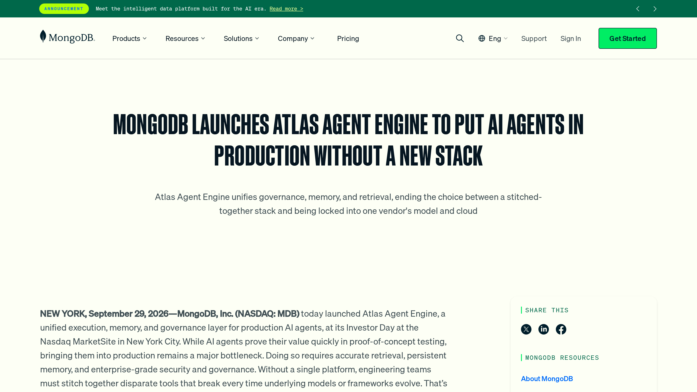 <!-- .element: style="max-height: 540px" -->

Note: The platform was announced on September 29, 2026. This is the public press release.

--

### Introducing the MongoDB Agentic Platform

<div style="position: relative">
<svg viewBox="40 190 1140 460" role="img" aria-label="MongoDB agentic platform architecture: a partner ecosystem on the left, the agent runtime, state and memory, lifecycle and cost controls in the middle, and an agent and tool catalog on the right" style="width:100%;max-height:560px"><rect x="48" y="200" width="1126" height="440" rx="6" fill="none" stroke="var(--muted)" stroke-dasharray="3 5"/><text text-anchor="middle" fill="var(--text)" font-size="21"><tspan x="154" y="240">Partner Ecosystem</tspan></text><text text-anchor="middle" fill="var(--text)" font-size="21"><tspan x="590" y="228">Agents and Tools developed in</tspan><tspan x="590" y="256.8">LangGraph, CrewAI …</tspan></text><text text-anchor="middle" fill="var(--text)" font-size="21"><tspan x="1004" y="228">Agents and Tools</tspan><tspan x="1004" y="256.8">Catalog</tspan></text><rect x="64" y="298" width="179" height="58" rx="14" fill="var(--code-bg)" stroke="var(--muted)"/><text text-anchor="middle" fill="var(--heading)" font-size="19"><tspan x="153.5" y="335.05">Evaluation</tspan></text><rect x="64" y="379" width="179" height="58" rx="14" fill="var(--code-bg)" stroke="var(--muted)"/><text text-anchor="middle" fill="var(--heading)" font-size="19"><tspan x="153.5" y="416.05">Observability</tspan></text><rect x="64" y="460" width="179" height="58" rx="14" fill="var(--code-bg)" stroke="var(--muted)"/><text text-anchor="middle" fill="var(--heading)" font-size="19"><tspan x="153.5" y="483.25">Model</tspan><tspan x="153.5" y="510.85">Management</tspan></text><rect x="64" y="541" width="179" height="58" rx="14" fill="var(--code-bg)" stroke="var(--muted)"/><text text-anchor="middle" fill="var(--heading)" font-size="19"><tspan x="153.5" y="564.25">Audit, Compliance</tspan><tspan x="153.5" y="591.85">&amp; IAM</tspan></text><rect x="304" y="277" width="857" height="347" fill="var(--accent)" stroke="var(--divider-accent)" stroke-width="2"/><rect x="326" y="297" width="527" height="34" rx="8" fill="var(--accent-soft)" stroke="none"/><text text-anchor="middle" fill="var(--heading)" font-size="19"><tspan x="589.5" y="322.05">Agent Framework Integrations</tspan></text><rect x="326" y="348" width="102" height="152" rx="22" fill="var(--accent-soft)" stroke="none"/><text text-anchor="middle" fill="var(--heading)" font-size="19"><tspan x="377" y="404.45">Agent</tspan><tspan x="377" y="432.05">Lifecycle</tspan><tspan x="377" y="459.65">Mgmt</tspan></text><rect x="440" y="348" width="148" height="152" rx="22" fill="var(--accent-soft)" stroke="none"/><text text-anchor="middle" fill="var(--heading)" font-size="19"><tspan x="514" y="418.25">Agent</tspan><tspan x="514" y="445.85">Runtime</tspan></text><rect x="600" y="348" width="141" height="152" rx="22" fill="var(--accent-soft)" stroke="none"/><text text-anchor="middle" fill="var(--heading)" font-size="19"><tspan x="670.5" y="418.25">Agent State</tspan><tspan x="670.5" y="445.85">&amp; Memory</tspan></text><rect x="753" y="348" width="98" height="152" rx="22" fill="var(--accent-soft)" stroke="none"/><text text-anchor="middle" fill="var(--heading)" font-size="19"><tspan x="802" y="418.25">Cost</tspan><tspan x="802" y="445.85">Controls</tspan></text><rect x="869" y="297" width="271" height="60" rx="10" fill="var(--accent-soft)" stroke="none"/><text text-anchor="middle" fill="var(--heading)" font-size="19"><tspan x="1004.5" y="321.25">MongoDB Provided</tspan><tspan x="1004.5" y="348.85">Tools and Agents</tspan></text><rect x="869" y="368" width="271" height="60" rx="10" fill="var(--accent-soft)" stroke="none"/><text text-anchor="middle" fill="var(--heading)" font-size="19"><tspan x="1004.5" y="406.05">Enterprise Catalog</tspan></text><rect x="869" y="439" width="271" height="60" rx="10" fill="var(--accent-soft)" stroke="none"/><text text-anchor="middle" fill="var(--heading)" font-size="19"><tspan x="1004.5" y="477.05">Agent &amp; Tool Marketplace</tspan></text><rect x="326" y="515" width="814" height="34" rx="8" fill="var(--accent-soft)" stroke="none"/><text text-anchor="middle" fill="var(--heading)" font-size="19"><tspan x="733" y="540.05">Security &amp; Governance</tspan></text><rect x="326" y="564" width="814" height="34" rx="8" fill="var(--accent-soft)" stroke="none"/><text text-anchor="middle" fill="var(--heading)" font-size="19"><tspan x="733" y="589.05">Run Anywhere</tspan></text></svg>
<div class="sales-band fragment"><span class="sales-line">Shut up with the sales pitch.</span><span class="sales-line fragment">Boxes tell me nothing. I want to <em>try</em> it.</span></div>
</div>

<p class="small" style="margin-top: 0.4em">⚠️ Atlas Agent Engine is in <strong>public preview</strong>: not yet recommended for production.</p>

Note: Say the preview status out loud: it is public preview and MongoDB does not recommend it for production yet. The platform's architecture, redrawn from the overview diagram. Everything this talk touches sits in the middle: the agent runtime and its state and memory. Click: the audience's inner voice. Click again for the second line. Alternates if you want to ad-lib: "shut up and take my money", "I want to try this, not hear about it", "every deck has this slide".

--

<!-- .slide: data-skippable="true" -->
### The front door

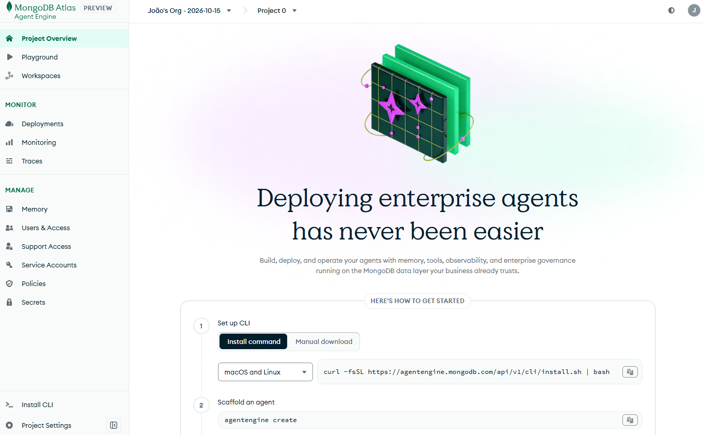 <!-- .element: style="max-height: 540px" -->

Note: The product's front door. "Deploying enterprise agents has never been easier", and step 2 is `agentengine create`. Sounds great. So: where's the Java SDK?

--

<!-- .slide: data-skippable="true" -->
### Python SDK: 200 ✅

<a href="https://www.mongodb.com/docs/agentengine/sdk/python/" target="_blank" rel="noopener">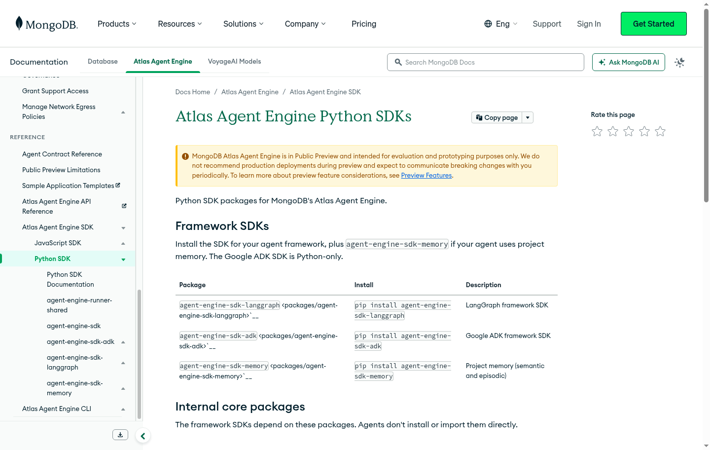</a>

Note: Python gets a documentation page: packages, install commands, the lot. TypeScript has one too. Now, the Java one.

--

### Java SDK: 404 ❌

<a href="https://www.mongodb.com/docs/agentengine/sdk/java/" target="_blank" rel="noopener">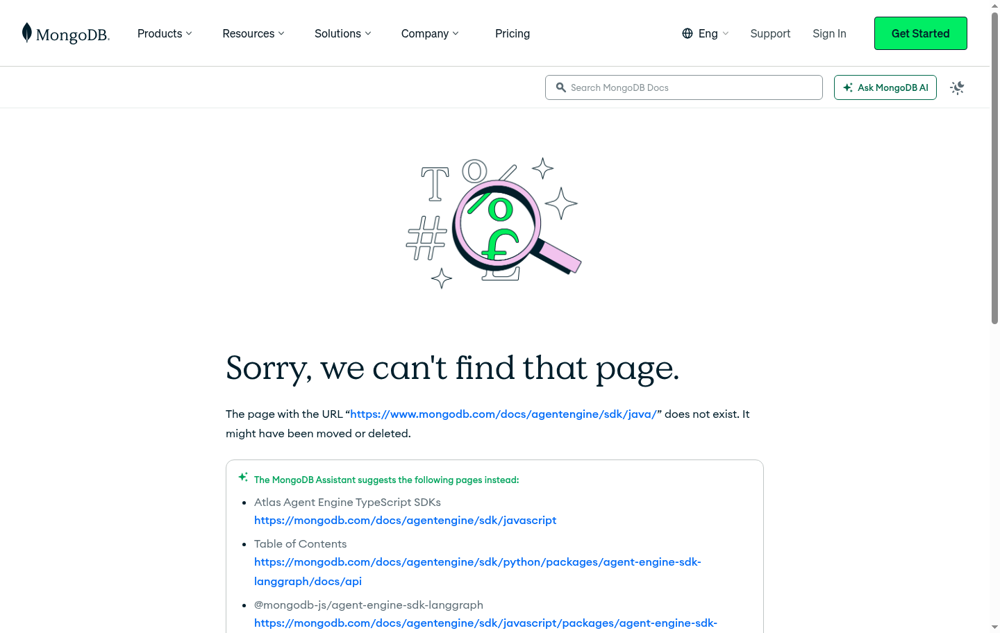</a>

Note: There isn't one. The docs have Python and TypeScript SDK pages, and this URL is a 404. Let it land, then go on to what the CLI says when you try anyway.

--

### The CLI says no

<div class="error" style="position: relative">

<span class="fragment annot" style="left: 40px; top: -2.3em"><span class="annot-text">worst name ever!</span><svg viewBox="0 0 70 60" width="56" height="48" style="display:block; margin: -0.1em 0 0 1.6em"><path d="M8 4 C 14 24, 22 34, 36 48" fill="none" stroke="currentColor" stroke-width="3.5" stroke-linecap="round"/><path d="M24 46 L38 51 L38 36" fill="none" stroke="currentColor" stroke-width="3.5" stroke-linecap="round" stroke-linejoin="round"/></svg></span>

```text
$ agentengine init

Error: unsupported language/framework combination "java-none"

(supported: python-langgraph, python-adk,
            python-openai-agents, typescript-langgraph)
```

</div>

This talk is about this error message. <!-- .element: class="fragment" -->

Note: 0:30. Cold open. Let it sit for a second, then click for the arrow, and once more for the line below. "We'll get back here in chapter 6. First, how we got to the point of being rejected."

--

<!-- .slide: data-skippable="true" -->
### The repo has no Java

<pre class="plain"><a href="https://github.com/mongodb/agent-engine-client-libraries">agent-engine-client-libraries</a>
<span class="fragment"> |
 ├── python/       ✅  SDK, memory, runner, LangGraph, ADK, OpenAI
</span><span class="fragment"> |
 ├── javascript/   ✅  SDK, memory, runner, LangGraph
</span><span class="fragment"> |
 └── java/         🫥</span></pre>

Note: Click once per folder. A public mirror of a private monorepo. The runner (the part that serves agents) isn't documented anywhere public.

--

### The plan

<div class="plan">
<span style="--i:0" class="step">core SDK</span><span style="--i:1" class="arrow">→</span><span style="--i:2" class="step">memory</span><span style="--i:3" class="arrow">→</span><span style="--i:4" class="step">LangChain4j</span><span style="--i:5" class="arrow">→</span><span style="--i:6" class="step">runner</span><span style="--i:7" class="arrow">→</span><span style="--i:8" class="step">LangGraph4j</span><span style="--i:9" class="arrow">→</span><span style="--i:10" class="step cloud">☁️</span>
</div>

<p class="big">How hard can it be?</p> <!-- .element: class="big fragment" -->

Note: The plan, in layers: standalone pieces first, the undocumented runner later. The layers appear on their own, one every third of a second. The runner step is the one nobody has documented. Click once for the last line: "Famous last words."

---

<!-- .slide: data-background-color="var(--divider)" -->
## <span class="divider-title"><span class="chapter">Chapter 2</span>But it works on my machine</span>

Note: 8:30. Section 2, about 3 minutes. The first contact with a real server.

--

<div class="track">
<span class="step here">core SDK</span><span class="arrow">→</span><span class="step">memory</span><span class="arrow">→</span><span class="step">LangChain4j</span><span class="arrow">→</span><span class="step">runner</span><span class="arrow">→</span><span class="step">LangGraph4j</span><span class="arrow">→</span><span class="step cloud">☁️</span>
</div>

### The core SDK

<ul style="font-size: 0.85em; line-height: 1.6">
<li class="fragment">📘 The models live in TypeScript (<a href="https://zod.dev/">zod</a> schemas)</li>
<li class="fragment">☕ Port them to Java <strong>records</strong>, same wire format</li>
<li class="fragment">🤖 Just <span class="rotator" data-words="Copilot|Cursor|Codex|Windsurf|Aider|Cline|Claude">Claude</span> your way through</li>
<li class="fragment">🟢 19 model tests, green on the first run</li>
</ul>

Note: Stage 1, the first brick in the plan. No server involved yet: can the TypeScript models become idiomatic Java without losing the wire format? One shared Jackson ObjectMapper (snake_case, no nulls), records for the models, and a generator for the 19 memory request types. All 19 model tests passed on the first run. Boring on purpose: it's the part that works, and the part everything else stands on.

--

<!-- .slide: data-skippable="true" -->
### Zod in, record out

<p class="filename">📄 models.ts</p>

```typescript
export const DocumentBlockSchema = z.object({
  type: z.literal("document").default("document"),
  url: z.string(),
  mime_type: z.string().optional(),
  filename: z.string().optional(),
});
```

<div class="fragment">

<p class="filename">📄 DocumentBlock.java</p>

```java
public record DocumentBlock(
    String url, String mimeType, String filename)
    implements ContentBlock {
  public DocumentBlock {
    Objects.requireNonNull(url, "url");  // required
  }
}
```

</div>

Note: One block from the SDK's models, side by side. The zod schema becomes a record: required fields are null-checked in the compact constructor, optional ones are just nullable, and mime_type becomes mimeType through one shared snake_case mapper. The type discriminator moves to the sealed interface (ContentBlock), so a document is never mistaken for an image that happens to share a url. Source: javascript/packages/agent-engine-sdk/src/models.ts and java/packages/agent-engine-sdk/.../DocumentBlock.java.

--

<!-- .slide: data-skippable="true" -->
<div class="track">
<span class="step">core SDK</span><span class="arrow">→</span><span class="step here">memory</span><span class="arrow">→</span><span class="step">LangChain4j</span><span class="arrow">→</span><span class="step">runner</span><span class="arrow">→</span><span class="step">LangGraph4j</span><span class="arrow">→</span><span class="step cloud">☁️</span>
</div>

### The memory SDK

<ul style="font-size: 0.85em; line-height: 1.6">
<li class="fragment">🐍 <strong>Memory Server</strong>: a Python web service</li>
<li class="fragment">☕ <strong>My SDK</strong>: the JDK's <code>HttpClient</code></li>
<li class="fragment">🧪 <strong>The tests</strong>: a fake server (<code>HttpServer</code>)</li>
</ul>

Note: Stage 2: the memory SDK, the part that stores and searches what an agent remembers. The client side is plain JDK, no HTTP library. The tests run against a tiny fake server in the same JVM: no mocking library, no Docker, fast and green.

--

### Problem #1: Tests pass, writes fail

<svg viewBox="0 0 900 300" role="img" aria-label="In the unit tests the Java client talks to a fake server that accepts the h2c upgrade; against the real server the body is dropped" style="width:100%;max-height:520px">
<defs><marker id="ok" viewBox="0 0 10 10" refX="9" refY="5" markerWidth="7" markerHeight="7" orient="auto"><path d="M0 0L10 5L0 10z" fill="var(--accent)"/></marker><marker id="bad" viewBox="0 0 10 10" refX="9" refY="5" markerWidth="7" markerHeight="7" orient="auto"><path d="M0 0L10 5L0 10z" fill="#D92D20"/></marker></defs>
<text x="40" y="30" fill="var(--muted)" font-weight="700" font-size="18" letter-spacing="1.5">🧪 IN THE UNIT TESTS</text>
<rect x="40" y="40" width="200" height="64" rx="12" fill="var(--accent-soft)" stroke="var(--accent)" stroke-width="2"/><text x="140.0" y="72.0" text-anchor="middle" font-weight="700" fill="var(--heading)" font-size="22">Java client</text><text x="140.0" y="96.0" text-anchor="middle" fill="var(--muted)" font-size="16">JDK HttpClient</text>
<rect x="660" y="40" width="200" height="64" rx="12" fill="var(--accent-soft)" stroke="var(--accent)" stroke-width="2"/><text x="760.0" y="72.0" text-anchor="middle" font-weight="700" fill="var(--heading)" font-size="22">Fake server</text><text x="760.0" y="96.0" text-anchor="middle" fill="var(--muted)" font-size="16">JDK HttpServer</text>
<line x1="244" y1="72" x2="654" y2="72" stroke="var(--accent)" stroke-width="3" marker-end="url(#ok)"/>
<text x="450" y="62" text-anchor="middle" font-family="var(--r-code-font)" font-size="17" fill="var(--text)">POST  Upgrade: h2c</text>
<text x="450" y="100" text-anchor="middle" font-weight="700" font-size="20" fill="var(--accent)">✅ 200 OK, whatever you send</text>
<g class="fragment">
<text x="40" y="180" fill="var(--muted)" font-weight="700" font-size="18" letter-spacing="1.5">🌍 AGAINST THE REAL THING</text>
<rect x="40" y="190" width="200" height="64" rx="12" fill="var(--accent-soft)" stroke="var(--accent)" stroke-width="2"/><text x="140.0" y="222.0" text-anchor="middle" font-weight="700" fill="var(--heading)" font-size="22">Java client</text><text x="140.0" y="246.0" text-anchor="middle" fill="var(--muted)" font-size="16">JDK HttpClient</text>
<rect x="660" y="190" width="200" height="64" rx="12" fill="var(--accent-soft)" stroke="var(--accent)" stroke-width="2"/><text x="760.0" y="222.0" text-anchor="middle" font-weight="700" fill="var(--heading)" font-size="22">Memory server</text><text x="760.0" y="246.0" text-anchor="middle" fill="var(--muted)" font-size="16">uvicorn + FastAPI</text>
<line x1="244" y1="222" x2="654" y2="222" stroke="#D92D20" stroke-width="3" marker-end="url(#bad)"/>
<text x="450" y="212" text-anchor="middle" font-family="var(--r-code-font)" font-size="17" fill="var(--text)">POST  Upgrade: h2c</text>
<text x="450" y="250" text-anchor="middle" font-weight="700" font-size="20" fill="#D92D20">❌ 422 Field required: the body is gone</text>
</g>
</svg>

Note: Stage 2, the memory SDK. I tested it the careful way: an in-process fake HTTP server, no mocking library, and everything went green. Click for the real memory server from the local stack: every single write fails.

--

<!-- .slide: data-skippable="true" -->
### What's h2c?

HTTP/2 <em>over cleartext</em>. No TLS, just plain `http://`.

<p class="fragment">The JDK <code>HttpClient</code> still <a href="https://docs.oracle.com/en/java/javase/17/docs/api/java.net.http/java/net/http/HttpClient.Builder.html#version(java.net.http.HttpClient.Version)">prefers HTTP/2</a>,<br>so it asks the server first:</p>

<div class="fragment">

```text
POST /… HTTP/1.1
Connection: Upgrade, HTTP2-Settings
Upgrade: h2c                            ← can we talk HTTP/2 instead?
```

</div>

<div class="bubbles">
<div class="bubble yes fragment fade-up">😎 "Sure, switching."<small><code>101</code> Switching Protocols</small></div>
<div class="bubble no fragment fade-up">🙄 "Nah, HTTP/1.1 it is."<small><code>200</code> OK, as if you never asked</small></div>
</div>

<p class="small">References: <a href="https://docs.oracle.com/en/java/javase/17/docs/api/java.net.http/java/net/http/HttpClient.Builder.html#version(java.net.http.HttpClient.Version)">JDK 17 <code>HttpClient.Builder.version()</code></a>, <a href="https://www.rfc-editor.org/rfc/rfc9110#section-7.8">RFC 9110 §7.8</a> (Upgrade), <a href="https://www.rfc-editor.org/rfc/rfc9110#section-15.2.2">§15.2.2</a> (101), <a href="https://www.rfc-editor.org/rfc/rfc7540#section-3.2">RFC 7540 §3.2</a> (h2c)</p>

Note: The "c" is for cleartext. With TLS, HTTP/2 is negotiated during the handshake; without it, the client sends an ordinary HTTP/1.1 request with an Upgrade header, which means "can we talk HTTP/2 instead?". Both answers are legal. The server may say yes (101 Switching Protocols, RFC 9110 section 15.2.2) or ignore the header and answer normally over HTTP/1.1, for example 200 OK (section 7.8: a server MAY ignore Upgrade). RFC 7540 section 3.2 is where h2c is defined, and it says requests with a body must be sent in their entirety before HTTP/2 frames start, which is the detail that bites later. The "prefers HTTP/2" claim is the JDK 17 Javadoc for HttpClient.Builder.version(): "If this method is not invoked prior to building, then newly built clients will prefer HTTP/2. If set to HTTP/2, then each request will attempt to upgrade to HTTP/2 ... If the upgrade fails, then the response will be handled using HTTP/1.1". Aside: RFC 9113, the current HTTP/2 spec, deprecated the h2c upgrade as never widely deployed, but the JDK client still does it. The question is what happens to the request body that comes with it. Keep this one brief.

--

<!-- .slide: data-skippable="true" -->
<div class="error">

#### The request body never arrived

```text
→ POST  Connection: Upgrade, HTTP2-Settings
        Upgrade: h2c
        (body: the memory write)

← 422   {"detail": [{"loc": ["body"], "msg": "Field required"}]}
```

</div>

Note: Click for the culprit.

--

### Why?

<div class="chat">
<div class="bubble client l fragment fade-up">☕ <strong>JDK client</strong>: "Can we talk HTTP/2? Also, here's my body."<small>POST + <code>Upgrade: h2c</code> + the memory write</small></div>
<div class="bubble server r fragment fade-up">🦄 <strong>uvicorn</strong>: "Upgrade? Body? What body?"<small>drops the body of the upgraded request</small></div>
<div class="bubble err r fragment fade-up">🐍 <strong>FastAPI</strong>: "Field required."<small><code>422</code> it sees an empty body</small></div>
<div class="bubble client l fragment fade-up">🧪 <strong>Fake test server</strong>: "Upgrade? Body? Sure, whatever."<small><code>200</code> it accepted the upgrade, so every test passed</small></div>
</div>

Note: The JDK HttpClient defaults to HTTP/2 and, over plain http, sends an h2c upgrade. Uvicorn drops the body of the upgraded request, so FastAPI sees an empty one and rejects the write. The fake server was happy to accept the upgrade, which is why every test passed.

--

### The fix

<p class="filename">📄 Http.java</p>

```diff
 HttpClient.newBuilder()
+    .version(HttpClient.Version.HTTP_1_1)  // h2c ate the body
     .connectTimeout(connectTimeout)
     .build();
```

<div class="fragment">

<p class="filename">📄 MemoryClientTest.java</p>

```java
@Test
void plainHttpRequestsDoNotAskForAnH2cUpgrade() {
  client().build().getDistinctDomains(null);
  assertNull(server.only().header("Upgrade"));
}
```

</div>

<p class="fragment" style="font-size: 1.1em">Fake servers only know what you taught them.</p>

Note: One line of fix, plus a regression test, trimmed here: the fake server records the request and the test asserts there is no Upgrade header. The code is from Http.java and MemoryClientTest.java in the SDK package. This would have broken every local-development user. The fake tolerated what the real server doesn't, so make fakes strict, and make them fail loudly.

--

### Problem #2: Embedding rate limit exceeded

<div class="error">

```text
searchSemantic

Error: Embedding service rate limit exceeded
```

</div>

Note: The first memory search that needs an embedding fails with a rate limit. Semantic search embeds the query with a Voyage AI model, and that call is being throttled. Easy: what limit?

--

<!-- .slide: data-skippable="true" -->
### Whose limit is it?

<div class="chat">
<div class="bubble client l fragment fade-up">🤖 <strong>Claude</strong>: "Rate limit? Must be a free key: 3 a minute."<small>guess #1. Right, but nobody believed it</small></div>
<div class="bubble server r fragment fade-up">📄 <strong>The docs</strong>: "New organizations get 2,000 RPM."<small><a href="https://www.mongodb.com/docs/voyageai/management/rate-limits/" style="color: inherit">Voyage rate limits</a>, usage tier 1</small></div>
<div class="bubble client l fragment fade-up">🤖 <strong>Claude</strong>: "Then it must be a project-level override."<small>told the human. Confidently. Wrong.</small></div>
<div class="bubble err r fragment fade-up">🪵 <strong>The log</strong>: "You have not yet added your payment method…"<small>"…reduced rate limits of <code>3 RPM</code> and 10K TPM"</small></div>
</div>

Note: First guess was right: a key on the free tier gets 3 requests a minute. Then I read the docs, which describe the paid tier, and told the human, confidently, that the limit must come from a project-level override. Wrong. The memory server's own log quoted Voyage AI the whole time: no payment method on file, so the reduced limits apply.

--

### The fix

<div class="flow auto" style="font-size: 0.85em">
<span style="--i:0"><span class="pill bad">❌ Rate limit exceeded</span></span><span style="--i:1"><span class="arrow">→</span><span class="pill">💳 Payment method added</span></span><span style="--i:2"><span class="arrow">→</span><span class="pill good">✅ Semantic search works</span></span>
</div>

<p class="fragment" style="font-size: 1.3em">Read the log before you theorize.</p>

Note: Adding a payment method lifted the limit. The docs described the paid tier; the log described this account. And a wrong correction should be retracted out loud, which I did. Let this last line sit.

---

<!-- .slide: data-background-color="var(--divider)" -->
## <span class="divider-title"><span class="chapter">Chapter 3</span>Tap the Wire</span>

Note: 11:30. Section 3, about 3 minutes. How do agents actually run?

--

<div class="track">
<span class="step">core SDK</span><span class="arrow">→</span><span class="step">memory</span><span class="arrow">→</span><span class="step here">LangChain4j</span><span class="arrow">→</span><span class="step">runner</span><span class="arrow">→</span><span class="step">LangGraph4j</span><span class="arrow">→</span><span class="step cloud">☁️</span>
</div>

### The LangChain4j adapter

<ul style="font-size: 0.85em; line-height: 1.6">
<li class="fragment">🔌 Any LangChain4j chat model becomes the platform's LLM</li>
<li class="fragment">🧪 45 offline tests, 6 live against OpenAI</li>
<li class="fragment">🟢 All green. Models: done</li>
<li class="fragment">🏃 Next up: the <strong>runner</strong></li>
</ul>

Note: Stage 3, in one breath: a LangChain4j chat model serves as the platform's BaseLLM, blocking and streaming, with translators for messages and tool schemas. 45 offline tests, then 6 live ones against the real OpenAI API: text, usage, streaming, tool calls, a tool result flowing back, early stream close. The models are the easy part. Now the one nobody documented.

--

<!-- .slide: data-skippable="true" -->
### Any model, one adapter

<p class="filename">📄 LangChain4jLiveTest.java</p>

```java
var llm = LangChain4jLLM.builder()
    .chatModel(OpenAiChatModel.builder()
        .apiKey(key).modelName("gpt-4o-mini").build())
    .build();
```

<div class="fragment">

```java
LLMResponse response = llm.invoke(
    List.of(Message.user("Reply with exactly the word: pong")));
// response.content() → "pong", response.usage() → tokens
```

</div>

Note: A LangChain4j chat model in, the platform's BaseLLM out. This is trimmed from the live test that ran against the real OpenAI API: the same adapter also takes a streaming model, and the call accepts kwargs like temperature and max_tokens. Swap OpenAiChatModel for any other LangChain4j provider and nothing else changes.

--

### The docs say no Java

<div class="track">
<span class="step">core SDK</span><span class="arrow">→</span><span class="step">memory</span><span class="arrow">→</span><span class="step">LangChain4j</span><span class="arrow">→</span><span class="step here">runner</span><span class="arrow">→</span><span class="step">LangGraph4j</span><span class="arrow">→</span><span class="step cloud">☁️</span>
</div>

> "Agents do not implement their own HTTP endpoint."
> <span class="small">— <a href="https://www.mongodb.com/docs/agentengine/reference/agent-contract/">the docs</a></span>

<p class="big fragment">So: no Java on the managed platform. 😬</p>

Note: The full sentence: "The Atlas Agent Engine imports the agent inside the same process as the agent sandbox." The platform loads an agent as module:attribute inside its own Python or Node runner image, and cloud builds run remotely from pyproject.toml or package.json. So a Java agent can't be built or deployed on the managed platform today. That's from the docs, not from a deployment attempt.

--

<!-- .slide: data-skippable="true" -->
### The way in

<p class="big">Then how do they talk? 🤔</p>

<div class="flow auto">
<span style="--i:0"><span class="pill">📖 The docs</span></span><span style="--i:1"><span class="arrow">→</span><span class="pill">🐍 The Python runner</span></span><span style="--i:2"><span class="arrow">→</span><span class="pill good">👀 Real traffic</span></span>
</div>

Note: Three steps. Read the docs: done, that was the quote. Read the Python runner, which is the part that isn't public. Then watch real traffic between the pieces.

--

### The local stack

<svg viewBox="0 0 900 400" role="img" aria-label="The local stack from agentengine dev up: the Orchestration Engine and MongoDB are real containers, and the OE calls the app container's agent runtime on port 8001 and tool server on port 8002. The app container is swapped from Python to Java" style="width:100%;max-height:520px">
<defs><marker id="sa" viewBox="0 0 10 10" refX="9" refY="5" markerWidth="6" markerHeight="6" orient="auto-start-reverse"><path d="M0 0L10 5L0 10z" fill="var(--accent)"/></marker><marker id="sm" viewBox="0 0 10 10" refX="9" refY="5" markerWidth="6" markerHeight="6" orient="auto-start-reverse"><path d="M0 0L10 5L0 10z" fill="var(--muted)"/></marker></defs>
<rect x="10" y="10" width="880" height="380" rx="18" fill="none" stroke="var(--muted)" stroke-width="2" stroke-dasharray="8 7"/>
<text x="30" y="40" text-anchor="start" font-weight="700" fill="var(--muted)" font-size="17">🐳 agentengine dev up</text>
<rect x="40" y="75" width="260" height="140" rx="12" fill="var(--accent-soft)" stroke="var(--accent)" stroke-width="2"/>
<text x="170" y="118" text-anchor="middle" font-weight="700" fill="var(--heading)" font-size="20">🧠 Orchestration Engine</text>
<rect x="110" y="140" width="120" height="30" rx="15" fill="var(--bg)" stroke="var(--muted)" stroke-width="1.5"/>
<text x="170" y="161" text-anchor="middle" font-weight="500" fill="var(--muted)" font-size="15">public image</text>
<text x="170" y="198" text-anchor="middle" font-weight="400" fill="var(--muted)" font-size="15">checks every call</text>
<rect x="40" y="275" width="260" height="90" rx="12" fill="var(--accent-soft)" stroke="var(--accent)" stroke-width="2"/>
<image href="img/mongodb-icon.svg" x="82" y="298" width="21" height="44"/>
<text x="185" y="315" text-anchor="middle" font-weight="700" fill="var(--heading)" font-size="20">MongoDB</text>
<text x="185" y="341" text-anchor="middle" font-weight="400" fill="var(--muted)" font-size="15">real, in Docker</text>
<path d="M170 217 L170 273" stroke="var(--muted)" stroke-width="2.5" fill="none" marker-start="url(#sm)" marker-end="url(#sm)"/>
<path d="M302 130 C 420 130, 430 205, 546 205" stroke="var(--accent)" stroke-width="3" fill="none" marker-end="url(#sa)"/>
<path d="M302 175 C 410 175, 430 310, 546 310" stroke="var(--accent)" stroke-width="3" fill="none" marker-end="url(#sa)"/>
<text x="316" y="119" text-anchor="start" font-weight="600" fill="var(--accent)" font-size="15" font-family="var(--r-code-font)">http://app:8001</text>
<text x="316" y="198" text-anchor="start" font-weight="600" fill="var(--accent)" font-size="15" font-family="var(--r-code-font)">http://app:8002</text>
<rect x="550" y="170" width="280" height="72" rx="12" fill="var(--bg)" stroke="var(--accent)" stroke-width="2"/>
<text x="690" y="201" text-anchor="middle" font-weight="700" fill="var(--heading)" font-size="19">agent runtime</text>
<text x="690" y="226" text-anchor="middle" font-weight="600" fill="var(--accent)" font-size="16" font-family="var(--r-code-font)">:8001</text>
<rect x="550" y="275" width="280" height="72" rx="12" fill="var(--bg)" stroke="var(--accent)" stroke-width="2"/>
<text x="690" y="306" text-anchor="middle" font-weight="700" fill="var(--heading)" font-size="19">tool server</text>
<text x="690" y="331" text-anchor="middle" font-weight="600" fill="var(--accent)" font-size="16" font-family="var(--r-code-font)">:8002</text>
<g class="fragment fade-out" data-fragment-index="0">
<rect x="520" y="62" width="340" height="305" rx="14" fill="none" stroke="var(--muted)" stroke-width="2" stroke-dasharray="6 6"/>
<image href="img/python.svg" x="560" y="84" width="34" height="34"/>
<text x="606" y="100" text-anchor="start" font-weight="700" fill="var(--heading)" font-size="20">app container</text>
<text x="606" y="124" text-anchor="start" font-weight="500" fill="var(--muted)" font-size="15">Python runner</text>
</g>
<g class="fragment" data-fragment-index="0">
<rect x="520" y="62" width="340" height="305" rx="14" fill="none" stroke="var(--accent)" stroke-width="4"/>
<image href="img/java.svg" x="566" y="82" width="26" height="36"/>
<text x="606" y="100" text-anchor="start" font-weight="700" fill="var(--heading)" font-size="20">app container</text>
<text x="606" y="124" text-anchor="start" font-weight="600" fill="var(--accent)" font-size="15" font-family="var(--r-code-font)">my-java-agent:dev</text>
</g>
</svg>

Note: `agentengine dev up` generates a compose file: the Orchestration Engine is a public image, MongoDB runs next to it, and there is one app container. The OE calls http://app:8001 (the agent runtime) and http://app:8002 (the tool server). Click: swap the app container for a Java one, and everything else stays real. That gave a test bed with no hosted platform.

--

<!-- .slide: data-skippable="true" -->
### Swap one container

The local stack's Orchestration Engine is a **public image**. Swap one container:

```yaml
services:
  app:
    image: my-java-agent:dev
    build: !reset null      # bye, Python
    volumes: !reset []
```

Note: A compose override: replace the app, drop the base file's build section and the source mounts. Everything else stays real.

--

<!-- .slide: data-skippable="true" -->
### Watching the baseline

<div class="error">

```text
$ agentengine invoke "…"

runtime_lost
```

</div>

<p class="fragment">The app's log: <em>"durable Memory identity is incomplete"</em></p>

<p class="fragment">The template has memory on. My request had no <code>user_id</code>. 🤦</p>

Note: First step: scaffold the Python hello-world-agent template, run it, and read both containers' logs. The first invoke failed with runtime_lost. The app log said the durable memory identity was incomplete: the template has memory enabled and my request carried no user_id. A runner rule I'd otherwise have discovered much later. With a user_id it worked, and the traffic told the story.

--

### The runtime asks first

<svg viewBox="0 0 900 556" role="img" aria-label="Request flow between the agent runtime, the Orchestration Engine and the model server" style="width:100%;max-height:560px;font-size:20px">
<defs><marker id="ah" viewBox="0 0 10 10" refX="9" refY="5" markerWidth="7" markerHeight="7" orient="auto"><path d="M0 0L10 5L0 10z" fill="var(--accent)"/></marker></defs>
<line x1="150" y1="52" x2="150" y2="546" stroke="var(--muted)" stroke-dasharray="5 6" opacity="0.6"/>
<rect x="40" y="6" width="220" height="46" rx="10" fill="var(--accent-soft)" stroke="var(--accent)" stroke-width="2"/>
<text x="150" y="36" text-anchor="middle" font-weight="700" fill="var(--heading)">Agent runtime</text>
<line x1="450" y1="52" x2="450" y2="546" stroke="var(--muted)" stroke-dasharray="5 6" opacity="0.6"/>
<rect x="340" y="6" width="220" height="46" rx="10" fill="var(--accent-soft)" stroke="var(--accent)" stroke-width="2"/>
<text x="450" y="36" text-anchor="middle" font-weight="700" fill="var(--heading)">Orchestration Engine</text>
<line x1="750" y1="52" x2="750" y2="546" stroke="var(--muted)" stroke-dasharray="5 6" opacity="0.6"/>
<rect x="640" y="6" width="220" height="46" rx="10" fill="var(--accent-soft)" stroke="var(--accent)" stroke-width="2"/>
<text x="750" y="36" text-anchor="middle" font-weight="700" fill="var(--heading)">Model server</text>
<g class="fragment">
<line x1="450" y1="108" x2="152" y2="108" stroke="var(--accent)" stroke-width="2.5" marker-end="url(#ah)"/>
<text x="300" y="99" text-anchor="middle" fill="var(--text)" font-family="var(--r-code-font)" font-size="17">POST /execute</text>
<text x="300" y="132" text-anchor="middle" fill="var(--muted)" font-size="15">the OE starts the agent</text>
</g>
<g class="fragment">
<line x1="150" y1="176" x2="448" y2="176" stroke="var(--accent)" stroke-width="2.5" marker-end="url(#ah)"/>
<text x="300" y="167" text-anchor="middle" fill="var(--text)" font-family="var(--r-code-font)" font-size="17">/tool/execute</text>
<text x="466" y="182" fill="var(--accent)" font-weight="700">① may I call the LLM?</text>
</g>
<g class="fragment">
<line x1="450" y1="244" x2="748" y2="244" stroke="var(--accent)" stroke-width="2.5" marker-end="url(#ah)"/>
<text x="600" y="235" text-anchor="middle" fill="var(--text)" font-family="var(--r-code-font)" font-size="17">/invoke_llm/stream</text>
<text x="600" y="268" text-anchor="middle" fill="var(--muted)" font-size="15">the OE runs the model, relays the stream</text>
</g>
<g class="fragment">
<line x1="150" y1="312" x2="448" y2="312" stroke="var(--accent)" stroke-width="2.5" marker-end="url(#ah)"/>
<text x="300" y="303" text-anchor="middle" fill="var(--text)" font-family="var(--r-code-font)" font-size="17">/tool/execute</text>
<text x="466" y="318" fill="var(--accent)" font-weight="700">② may I run this tool?</text>
</g>
<g class="fragment">
<line x1="150" y1="380" x2="448" y2="380" stroke="var(--accent)" stroke-width="2.5" marker-end="url(#ah)"/>
<text x="300" y="371" text-anchor="middle" fill="var(--text)" font-family="var(--r-code-font)" font-size="17">/tool/result</text>
<text x="300" y="404" text-anchor="middle" fill="var(--muted)" font-size="15">tool ran locally, runtime reports</text>
</g>
<g class="fragment">
<line x1="150" y1="448" x2="448" y2="448" stroke="var(--accent)" stroke-width="2.5" marker-end="url(#ah)"/>
<text x="300" y="439" text-anchor="middle" fill="var(--text)" font-family="var(--r-code-font)" font-size="17">/tool/execute</text>
<text x="466" y="454" fill="var(--accent)" font-weight="700">③ LLM again, with the result</text>
</g>
<g class="fragment">
<line x1="150" y1="516" x2="448" y2="516" stroke="var(--accent)" stroke-width="2.5" marker-end="url(#ah)"/>
<text x="300" y="507" text-anchor="middle" fill="var(--text)" font-family="var(--r-code-font)" font-size="17">/executor/callback</text>
<text x="466" y="522" fill="var(--accent)" font-weight="700">✅ COMPLETED: final answer</text>
</g>
</svg>

Note: Mapped from the Python source and the OE's logs. The runtime never calls a model or tool on its own: it asks the OE first, and the OE applies policy and keeps the audit trail: 1. The OE starts a turn with POST /execute, 2. The runtime wants the LLM, so it asks /tool/execute. The OE approves and returns a stream URL, 3. The OE calls the model server (/invoke_llm/stream) and relays the chunks back to the runtime, 4. The model asked for a tool. Same dance: /tool/execute. For a local tool the OE answers "run it yourself", 5. The runtime runs the tool and reports the outcome on /tool/result, 6. LLM again, now with the tool result in context, 7. Done: /executor/callback with COMPLETED.

--

### Will the OE accept a Java container?

<div class="chat">
<div class="bubble client l fragment fade-up">☕ <strong>Java runtime</strong>: "Hi. I'm <code>language=java</code>."<small><code>POST</code> /agent/capabilities</small></div>
<div class="bubble server r fragment fade-up">🧠 <strong>The OE</strong>: "…Sure. Come in."<small><code>200</code> OK</small></div>
</div>

<div class="fragment">

```json
{
  "result": "Hello ana, from a Java agent!",
  "status": "completed"
}
```

</div>

<p class="fragment" style="font-size: 1.1em">The OE didn't care that I'm Java. 🎉</p>

Note: Slice 1 of the runner: two JDK HttpServers, no web framework, a launcher that reads agent.yaml and loads the agent class, and at startup the runtime advertises its capabilities to the OE and refuses to serve if rejected. The big unknown was whether the OE rejects unfamiliar languages. It turned out to be nothing. Then a real invoke: a Java agent, answering through the real Orchestration Engine.

---

<!-- .slide: data-background-color="var(--divider)" -->
## <span class="divider-title"><span class="chapter">Chapter 4</span>Graphs, Threads and Amnesia</span>

Note: 14:30. Section 4, about 4 minutes. LangGraph4j, memory and human-in-the-loop. Three problems, one per bullet on the next slide.

--

### An agent as a graph

<div class="flow auto">
<span style="--i:0"><span class="pill">🟢 START</span></span><span style="--i:1"><span class="arrow">→</span><span class="pill">🤖 agent</span></span><span style="--i:2"><span class="arrow">⇄</span><span class="pill">🔧 tools</span></span><span style="--i:3"><span class="arrow">→</span><span class="pill good">🏁 END</span></span>
</div>

<blockquote class="fragment" style="font-size: 0.8em">"<em>nodes do the work, edges tell what to do next</em>."<br><span class="small">— <a href="https://docs.langchain.com/oss/python/langgraph/graph-api#graphs">LangGraph docs, Graph API › Graphs</a></span></blockquote>

<ol style="font-size: 0.8em">
<li class="fragment">🧵 <strong>Threads</strong>: nodes run on LangGraph4j's own workers</li><br>
<li class="fragment">💾 <strong>Checkpoints</strong>: the state saved after every node</li><br>
<li class="fragment">⏸️ <strong>Pauses</strong>: a human decides when the graph resumes</li>
</ol>

Note: The graph draws itself when the slide opens. A LangGraph4j agent is a graph. The agent node calls the model, the tools node runs what the model asks for, and they loop until the model is done. The state travels along and is checkpointed after every node. Three features, three problems: threads, checkpoints and pauses.

--

### Problem #3: No execution on this thread

<div class="error">

```text
IllegalStateException: No execution is active on this thread
```

</div>

Note: First run of a graph agent through the SDK. Click for who is to blame.

--

<!-- .slide: data-skippable="true" -->
### Whose thread is it?

<div class="chat">
<div class="bubble client l fragment fade-up">🧵 <strong>My SDK</strong>: "The execution lives on the thread that started it."<small>a thread-bound scope, so nothing gets passed around</small></div>
<div class="bubble server r fragment fade-up">🕸️ <strong>LangGraph4j</strong>: "Cool, I run every node on my own worker."<small>a different thread for each node</small></div>
<div class="bubble err r fragment fade-up">💥 <strong>The worker</strong>: "Execution? What execution?"<small><code>IllegalStateException</code></small></div>
<div class="bubble client l fragment fade-up">🧪 <strong>A unit test</strong>: "Caught it. Before the live agent did."<small>the graph test, not the demo</small></div>
</div>

Note: LangGraph4j runs nodes on its own worker threads, where my thread-bound execution scope was invisible. A test caught it before the live agent did.

--

### The fix

<p class="filename">📄 ScopedExecutor.java</p>

```java
// on the thread that has the execution
this.execution = ExecutionScope.current();

// on whichever worker picks the task up
POOL.execute(() ->
    ExecutionScope.call(execution, task));
```

<div class="fragment">

<p class="filename">📄 LangGraph4jAgent.java</p>

```diff
 RunnableConfig.builder().threadId(threadId)
+    .emitterExecutor(new ScopedExecutor())
```

</div>

<p class="fragment" style="font-size: 1.1em">Context tied to a thread stays on that thread.</p>

Note: LangGraph4j lets you supply the executor it uses for its nodes. ScopedExecutor is created on the thread that holds the execution, so it remembers it. Every task given to it is wrapped to run inside that same execution on whatever worker picks it up. Then the config just hands it to LangGraph4j. Trimmed from ScopedExecutor.java and LangGraph4jAgent.java.

--

### Problem #4: The agent forgets

<div class="chat">
<div class="bubble client l fragment fade-up">🧑 "My name is Ana and I love sailing."</div>
<div class="bubble server r fragment fade-up">🤖 "Nice to meet you, Ana!"</div>
<div class="bubble client l fragment fade-up">🧑 "What's today's date? Use your tool."</div>
<div class="bubble server r fragment fade-up">🤖 "🔧 It's 2026-10-16."</div>
<div class="bubble client l fragment fade-up">🧑 "What's my name?"</div>
<div class="bubble err r fragment fade-up">🤷 "I don't know. We haven't met."</div>
</div>

Note: Three turns on the same thread through the real OE. The third answer is the problem.

--

<!-- .slide: data-skippable="true" -->
### Why?

<div class="chat">
<div class="bubble client l fragment fade-up">💾 <strong>The checkpointer</strong>: "I saved the state after every node."<small>so far, so good</small></div>
<div class="bubble server r fragment fade-up">🕸️ <strong>LangGraph4j</strong>: "The run ended. I released the thread."<small>the default: release a thread's checkpoints at the end of a run</small></div>
<div class="bubble err r fragment fade-up">🧹 <strong>The next turn</strong>: "Blank page."<small>nothing left to resume from</small></div>
</div>

<p class="fragment" style="font-size: 1.1em">One agent turn is one run. A conversation is many.</p>

Note: LangGraph4j releases a thread's checkpoints when a run ends. Every user message is a new run, so the history was gone before the next one started.

--

### The fix

<p class="filename">📄 App.java</p>

```diff
 CompileConfig.builder()
     .checkpointSaver(checkpointer)
+    .releaseThread(false)   // keep it after the run
```

<div class="fragment">

<p class="filename">📄 LangGraph4jAgent.java</p>

```java
// one session, one thread, every turn
threadId(session, workspaceId)
```

</div>

<div class="chat">
<div class="bubble server r fragment fade-up">⛵ "Your name is Ana, and you love sailing."</div>
</div>

Note: Two small things. The flag, in App.java, tells LangGraph4j to keep a thread's checkpoints when a run ends. And the platform's session id, scoped to the workspace so agents sharing a store can't collide, becomes the checkpointer's thread id, so every turn of a conversation lands on the same thread. One flag later, three turns through the real OE, memory intact.

--

### Memory that doesn't last ⚠️

<div class="flow" style="flex-wrap: wrap; font-size: 1.1em">
<span class="pill">Postgres</span><span class="pill">Redis</span><span class="pill">MySQL</span><span class="pill">Oracle</span><span class="pill">SQLite</span><span class="pill">DynamoDB</span><span class="pill">CockroachDB</span><span class="pill">Hazelcast</span><span class="pill bad fragment">🍃 MongoDB</span>
</div>

<p class="fragment" style="font-size: 1.1em">Restart the runtime and the agent forgets again.</p>

Note: The checkpointer I used lives in memory, so memory survives turns but not restarts. LangGraph4j has savers for CockroachDB, DynamoDB, Hazelcast, MySQL, Oracle, Postgres, Redis and SQLite. There is no MongoDB saver, and I searched the issues and PRs for one. A platform built on MongoDB, with no MongoDB saver. So, an issue.

--

<!-- .slide: data-skippable="true" -->
### Issue #492: a MongoDB saver

<a href="https://github.com/langgraph4j/langgraph4j/issues/492" target="_blank" rel="noopener">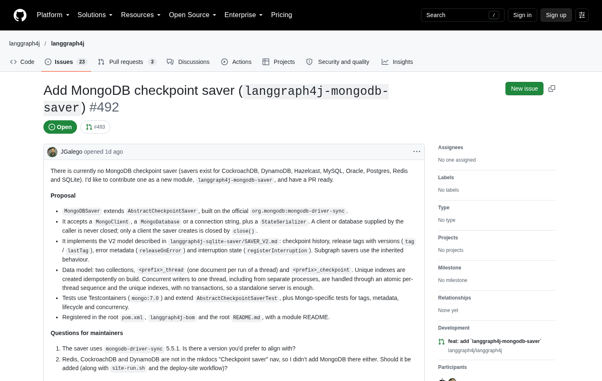</a>

Note: Opened first, with a proposal and two questions for the maintainers: which driver version, and whether it belongs in the docs nav. Ask before you send a thousand lines.

--

### PR #493: the saver

<div style="position: relative; display: inline-block; margin-right: 170px">
<a href="https://github.com/langgraph4j/langgraph4j/pull/493" target="_blank" rel="noopener" style="display: grid">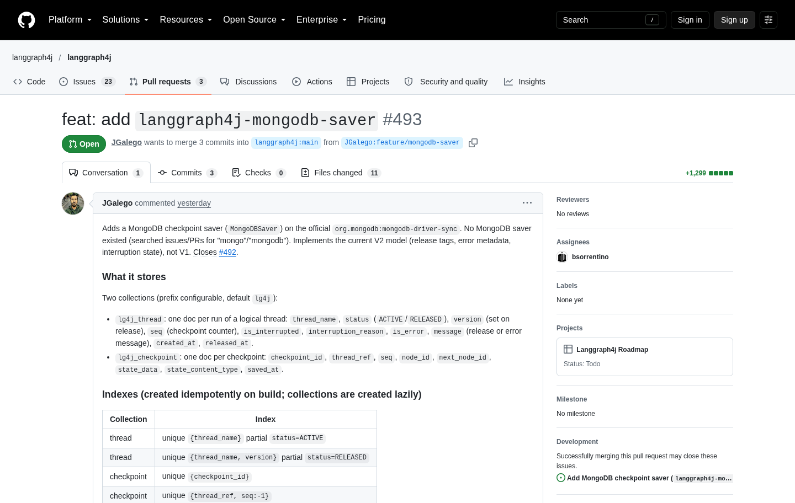</a>
<span class="fragment annot" data-fragment-index="1" style="left: 91%; top: 70%; display: flex; align-items: center; gap: 0.2em; transform: translateY(-50%) rotate(-4deg)"><svg viewBox="0 0 70 40" width="70" height="40" style="flex: none"><path d="M66 22 C 46 30, 26 28, 9 18" fill="none" stroke="currentColor" stroke-width="3.5" stroke-linecap="round"/><path d="M23 18.6 L9 18 L16.3 29.9" fill="none" stroke="currentColor" stroke-width="3.5" stroke-linecap="round" stroke-linejoin="round"/></svg><span class="annot-text" style="white-space: normal; line-height: 1.05">on the<br>roadmap!</span></span>
<span class="fragment annot" data-fragment-index="3" style="color: #D93025; left: 91%; top: 29%; display: flex; align-items: center; gap: 0.2em; transform: translateY(-50%) rotate(-4deg)"><svg viewBox="0 0 70 40" width="70" height="40" style="flex: none"><path d="M66 22 C 46 30, 26 28, 9 18" fill="none" stroke="currentColor" stroke-width="3.5" stroke-linecap="round"/><path d="M23 18.6 L9 18 L16.3 29.9" fill="none" stroke="currentColor" stroke-width="3.5" stroke-linecap="round" stroke-linejoin="round"/></svg><span class="annot-text" style="white-space: normal; line-height: 1.05">merged!<br>🎉</span></span>
</div>

Note: The PR closes the issue. Two collections, one for threads and one for checkpoints, unique indexes, no transactions so a standalone server is enough, and Testcontainers tests that include concurrent writers. Click once for the roadmap note, then once more: the screenshot flips from open to merged (October 18), the roadmap note stays. Click again for the red merged arrow. Until a release ships it, the Java runtime keeps its checkpoints in memory.

--

### Problem #5: The resume decision is nested

<div class="flow auto">
<span style="--i:0"><span class="pill">🛑 Suspend</span></span><span style="--i:1"><span class="arrow">→</span><span class="pill">⏳ OE waits</span></span><span style="--i:2"><span class="arrow">→</span><span class="pill">🧑 Human approves</span></span><span style="--i:3"><span class="arrow">→</span><span class="pill good">▶️ OE redispatches</span></span>
</div>

```java
throw new SuspendException("awaiting_human_review", context);
```

<p class="fragment" style="font-size: 1.1em">What does the agent receive when it comes back? 🤔</p>

Note: Human in the loop. The agent throws a SuspendException, the OE parks the execution, a human approves, and the OE redispatches the agent with resume data.

--

<!-- .slide: data-skippable="true" -->
### What did the OE actually send?

<div class="chat">
<div class="bubble client l fragment fade-up">🤖 <strong>Claude</strong>: "Easy. <code>resumeData.decision</code>."<small>guess #1, from the docs. Read an empty string.</small></div>
<div class="bubble server r fragment fade-up">🧠 <strong>The OE</strong>: "I nested it: <code>human_review</code>, then <code>decision</code>."<small>not in the docs</small></div>
<div class="bubble err r fragment fade-up">🖨️ <strong>The demo agent</strong>: "Here's what arrived."<small>it printed the payload. Mystery solved.</small></div>
</div>

<p class="fragment" style="font-size: 1.1em">When the docs are silent, print what arrived.</p>

Note: The docs didn't say it was nested; printing what arrived settled it.

--

### The fix

<p class="filename">📄 ApprovalAgent.java</p>

```diff
-ctx.resumeData().path("decision")
+ctx.resumeData().path("human_review").path("decision")
```

<div class="fragment">

<p class="filename">🧑 The reviewer's answer</p>

```http
POST /resume/<execution-id>
{"human_review": {"decision": "approve"}}
```

</div>

<div class="chat">
<div class="bubble client l fragment fade-up">👍 <code>approve</code> → "Approved, going ahead."</div>
<div class="bubble err r fragment fade-up">👎 <code>reject</code> → "Not approved, nothing was done."</div>
</div>

Note: The agent gets back exactly what the reviewer sent, under the key of the resume request body, which is human_review on the local OE. So the decision is one level down. The managed platform's resume endpoint takes a flat decision and nests it for you, which is why the docs never mention it. Both paths were exercised against the real OE: the approval agent suspended on the first call, and completed after approve and after reject. The code is from the approval-agent example.

---

<!-- .slide: data-background-color="var(--divider)" -->
## <span class="divider-title"><span class="chapter">Chapter 5</span>Reports, Not Findings</span>

Note: 18:30. Section 5, about 2 minutes. Back to the Near Miss data: what went wrong in retrieval, and what the agent may claim.

--

### Problem #6: Every pump query returns boilerplate

<div class="error">

```text
> insulin pump delivered too much insulin

1. "insufficient information regarding a device problem…"
```

</div>

Note: The same non-answer ranked first for every pump query. Click for the culprit.

--

<!-- .slide: data-skippable="true" -->
### Why?

<div class="chat">
<div class="bubble client l fragment fade-up">🧮 <strong>MiniLM</strong>: "I read 256 wordpieces. The rest is cut."<small>so long narratives get split into chunks</small></div>
<div class="bubble server r fragment fade-up">🏥 <strong>A MAUDE narrative</strong>: "…and then the manufacturer's boilerplate."<small>the later chunks say nothing about the event</small></div>
<div class="bubble err r fragment fade-up">🔎 <strong>The index</strong>: "Boilerplate is close to everything."<small>so it ranked first for every query</small></div>
</div>

<p class="fragment" style="font-size: 1.1em">Generic text is close to every question.</p>

Note: MiniLM reads 256 wordpieces, so MAUDE narratives need chunking. The later chunks of a long narrative are manufacturer boilerplate, such as "insufficient information regarding a device problem", which ranked first for every pump query.

--

### The fix

<p class="filename">📄 MaudeIngestor.java</p>

```java
// 120 words a chunk, 30 shared, and only the first chunk
TextChunks.split(narrative, 120, 30, 1)
```

<p class="fragment" style="font-size: 1.1em">Keep the part where someone says what happened.</p>

Note: Only the first chunk of each MAUDE narrative is kept, which is where the reporter describes the event. NHTSA complaints keep up to three chunks.

--

<!-- .slide: data-skippable="true" -->
### Reports, not findings

<p class="filename">📄 NearMissAgent.java · the system prompt</p>

```text
The reports are submissions, not findings. Never say that a
device, a vehicle or an aircraft is defective, that it caused
an outcome, or what a patient, driver or pilot should do.
Point to the report instead.
```

Note: Part of the agent's system prompt. A report says what somebody submitted. Nobody has confirmed it. With medical and aviation data the agent has to know that.

--

### A report is a claim

<div class="chat">
<div class="bubble client l fragment fade-up">🏥 <strong>A report</strong>: "The pump was confirmed defective by medical staff."<small>what somebody submitted</small></div>
<div class="bubble server r fragment fade-up">🤖 <strong>The agent</strong>: "One report states that the pump was defective."<small>attributed, with the report number</small></div>
<div class="bubble err r fragment fade-up">🚫 <strong>Never</strong>: "The pump is defective."<small>nobody confirmed it</small></div>
</div>

Note: A claim inside a report is relayed only as what the report says. The first build did not do this, and it also did not clearly decline to give advice. One added prompt line fixed both: decline advice, name the manufacturer, a clinician or the agency, and relay claims only as what the report says. The real answer is in chapter 7.

--

<!-- .slide: data-skippable="true" -->
### When is a connection real?

<div class="flow" style="flex-wrap: wrap">
<span class="pill good">📄 same report</span><span class="pill good">🏷️ same product code</span><span class="pill good">🚙 same vehicle</span><span class="pill good">🛩️ same aircraft</span><span class="pill good">📚 same report set</span>
</div>

<p class="fragment" style="font-size: 1.1em"><code>correlate_evidence</code> sets <code>verified_connection: true</code> only when two records share one of these.</p>

Note: The correlate_evidence tool marks verified_connection only when two records share provenance stored at ingest. Even then it says what is verified, a grouping in the source data, and not that the two reports describe the same event. A shared publisher name is a catalog attribution.

--

### A pacemaker and a Tesla

<div class="chat">
<div class="bubble client l fragment fade-up" style="max-width: 100%">🧑 "Is there a verified connection between the pacemaker reports and the Tesla Model 3 complaints about sudden loss of power?"</div>
</div>

<div class="fragment" style="font-size: 0.8em; text-align: left; display: table; margin: 0.6em auto 0">
<p style="margin: 0.3em 0"><span class="flow" style="display: inline-flex; margin: 0"><span class="pill good">verified_same_*</span></span> &nbsp;shared report, product code, vehicle, aircraft…</p>
<p style="margin: 0.3em 0"><span class="flow" style="display: inline-flex; margin: 0"><span class="pill">analogous_pattern</span></span> &nbsp;similar vectors, collected independently</p>
<p style="margin: 0.3em 0"><span class="flow" style="display: inline-flex; margin: 0"><span class="pill bad">independent</span></span> &nbsp;similarity below the reporting cutoff</p>
</div>

Note: The question is the one asked of the managed deployment in chapter 7. The correlate_evidence tool can only answer with a few relationships. The verified ones need provenance shared at ingest. Without it, the best a similar pair can get is analogous_pattern, a pattern in one embedding space, and below the reporting cutoff it is just independent.

--

<!-- .slide: data-skippable="true" -->
### What the tool said

<div class="chat">
<div class="bubble server r fragment fade-up">🔧 <strong>correlate_evidence</strong><small>MAUDE record vs NHTSA record</small></div>
</div>

<div class="fragment">

```json
{
  "left_dataset_id": "fda-maude",
  "right_dataset_id": "nhtsa-complaints",
  "relationship": "independent",
  "verified_connection": false,
  "explanation": "…The datasets were collected independently.
                  This is not a verified connection."
}
```

</div>

<div class="chat">
<div class="bubble server r fragment fade-up">🤖 "There is no verified connection."</div>
</div>

Note: Real tool output, trimmed. Both reports mention a sudden loss of power and their vectors are close, but the datasets share no report, product, vehicle or report set. The agent may only call two records connected if they share provenance. Similar vectors from unrelated datasets are an analogy, and it says so.

---

<!-- .slide: data-background-color="var(--divider)" -->
## <span class="divider-title"><span class="chapter">Chapter 6</span>The Stowaway Agent</span>

Note: 20:30. Section 6, about 5 minutes. Back to the error from the start, then the workaround, then the five things that broke on the way to a deployed agent. Deployed means nothing until it answers.

--

### The wall

<div class="error">

```text
$ agentengine init

Error: unsupported language/framework combination "java-none"
```

</div>

<div class="chat">
<div class="bubble client l fragment fade-up">🤞 <strong>Me</strong>: "A hidden option: <code>AGENTENGINE_IMAGE_SOURCE=custom</code>. Can I bring my own image?"</div>
<div class="bubble err r fragment fade-up">🔎 <strong>The template</strong>: "I only mirror the CLI binary and the dev-stack images."<small>from <code>agent source template --stdout</code></small></div>
</div>

Note: Back to the error from the start. The CLI reads the language and framework and rejects java before anything reaches the server. The hidden AGENTENGINE_IMAGE_SOURCE=custom option, which agentengine agent source template shows, only mirrors the CLI binary and the dev-stack images. It does not deploy your own agent image.

--

<!-- .slide: data-skippable="true" -->
### No Java, no Maven

<div style="display: table; margin: 0 auto">
<div class="flow" style="font-size: 0.9em; justify-content: flex-start"><span class="pill" style="min-width: 11em; text-align: center">🐍 <code>pyproject.toml</code></span><span class="arrow">→</span><span class="pill good"><code>runner-base-python-lite</code></span></div>

<div class="flow fragment" style="font-size: 0.9em; justify-content: flex-start"><span class="pill" style="min-width: 11em; text-align: center">🟨 <code>package.json</code></span><span class="arrow">→</span><span class="pill good"><code>runner-base-typescript-langgraph</code></span></div>

<div class="flow fragment" style="font-size: 0.9em; justify-content: flex-start"><span class="pill" style="min-width: 11em; text-align: center">☕ <code>pom.xml</code></span><span class="arrow">→</span><span class="pill bad">🤷 nothing</span></div>
</div>

Note: The CLI knows two runner base images and reads pyproject.toml or package.json. A Java agent has neither a Java base image nor a Java build step.

--

### The loophole

<div class="chat">
<div class="bubble server l fragment fade-up">🏗️ <strong>The platform</strong>: "I import whatever <code>agent.yaml</code> names, check that it's a <code>BaseApp</code>, and call <code>run()</code>."</div>
</div>

```python
app = _load_app(config["entrypoint"])   # must be a BaseApp
app.run()
```

<p class="fragment">Nobody said <code>run()</code> has to return.</p>

Note: The runner image imports whatever agent.yaml names, checks it's a BaseApp, and calls run().

--

### The stowaway

<p class="filename">📄 java_shim/__init__.py</p>

```python
class JavaApp(BaseApp):
    def run(self):
        from jdk4py import JAVA          # a JDK... from pip
        os.execv(str(JAVA), [str(JAVA), "-cp", "java/lib/*",
                  "com.mongodb.agentengine.runner.Launcher"])

app = JavaApp("java-agent")
```

<ol style="font-size: 0.8em">
<li class="fragment">🐍 A Python package on paper</li>
<li class="fragment">☕ A JRE from PyPI inside a wheel</li>
<li class="fragment">📦 Prebuilt jars in the source tree</li>
</ol>

Note: os.execv replaces the Python process with the JVM. Same PID, same environment, same ports. The JRE comes from a PyPI wheel (jdk4py, a trimmed Temurin). Prebuilt jars ship in the source tree.

--

### Will the build buy it?

```text
$ agentengine build logs bld_01M524H4BZG1YJJJQRGJ5NZ6JM

2026-10-16T10:36:50Z Detected agent language: python

2026-10-16T10:37:02Z Using entrypoint: java_shim:app
```

<div class="chat">
<div class="bubble server r fragment fade-up">🏗️ <strong>The platform</strong>: "Ah yes, a Python agent." 🐍</div>
</div>

Note: The managed build happily installed our "Python" project. It never imports the entrypoint at build time, so the shim needs no build-time guard.

--

### Problem #7: The agent never starts

<div class="error">

```text
$ agentengine invoke "Hello from the managed platform"

    The agent did not become ready during startup.

$ agentengine logs --source agent

    SSLHandshakeException: PKIX path building failed
```

</div>

Note: The build and the deploy both succeeded. The invoke failed. The agent log told the story: the JVM starts, the tool sandbox comes up, and the agent sandbox dies when it advertises its capabilities to the Orchestration Engine. The runner refuses to serve without the advertisement, so it never becomes ready.

--

### Who's to blame?

<div class="chat">
<div class="bubble client l fragment fade-up">🤖 <strong>Claude</strong>: "A private CA. Python trusts it, Java doesn't."<small>so I wrote a launcher that merged the bundles</small></div>
<div class="bubble err r fragment fade-up">🪵 <strong>The log</strong>: "Only the usual public CAs. No private one."<small>after the redeploy the handshake still failed</small></div>
<div class="bubble server r fragment fade-up">🧠 <strong>The OE</strong>: "I want a client certificate."<small>mutual TLS: the client has to prove who it is, not only the server</small></div>
<div class="bubble client l fragment fade-up">🐍 <strong>The Python runner</strong>: "<code>TLS_CERT_PEM</code>, <code>TLS_KEY_PEM</code>, <code>TLS_CA_CERT_PEM</code>. If any of the three is missing I refuse to connect."<small>the contract was written down only in <code>tls_client.py</code></small></div>
</div>

Note: First theory: the platform uses a private CA that Python trusts and Java doesn't. I wrote a launcher that merged the bundles and redeployed. The log showed the system bundle was the public one and the handshake still failed. The real contract was in the Python runner's tls_client.py: the agent runtime talks to the OE over mutual TLS. The platform hands the runtime a client certificate, key and CA as environment variables.

--

### The fix

<p class="filename">📄 PlatformTls.java</p>

```java
// trust only the platform's CA
trust.setCertificateEntry("ca-" + index++, anchor);

// present the platform's client certificate and key
identity.setKeyEntry("client", privateKey, noPassword, chain);

context.init(keyManagers, trustManagers, null);
```

<p class="fragment" style="font-size: 1.1em">Built from the three <code>TLS_*</code> variables. No certificate, no connection.</p>

Note: The runner now builds its SSL context from TLS_CERT, TLS_KEY and TLS_CA_CERT, each from a path or inline PEM. It presents the client certificate and trusts only the platform CA, as the Python runner does. If any of the three is missing it refuses to connect, instead of falling back. The first version of this lived in the shim and changed the JVM's default context. It now lives in the runner's own client, so every other HTTPS call keeps the default. Tested against an HTTPS server that requires a client certificate.

--

<!-- .slide: data-skippable="true" -->
### One more catch: the key

<div class="chat">
<div class="bubble client l fragment fade-up">☕ <strong>Java</strong>: "I only read keys that start with <code>BEGIN PRIVATE KEY</code>."<small>the PKCS#8 format</small></div>
<div class="bubble server r fragment fade-up">🔑 <strong>The platform</strong>: "Mine may start with <code>BEGIN RSA PRIVATE KEY</code> or <code>BEGIN EC PRIVATE KEY</code>."<small>the older PKCS#1 and SEC1 formats</small></div>
</div>

<p class="filename">📄 PlatformTls.java</p>

```java
case "RSA PRIVATE KEY" ->
    der(0x30, concat(INTEGER_ZERO, RSA_ALGORITHM, der(0x04, der)));
```

<p class="fragment" style="font-size: 1.1em">The older keys get wrapped in a PKCS#8 envelope by hand.</p>

Note: The JDK parses only PKCS#8 private keys. The platform's key may come as PKCS#1 for RSA or SEC1 for EC. Wrapping one in a PKCS#8 envelope is a short fixed ASN.1 structure: a version number, the algorithm identifier, and the key bytes as an octet string. The code handles all three formats, and the tests use each. Living the dream.

--

### Problem #8: The package is too big

<div class="error">

```text
object exceeds 52428800 byte limit
```

</div>

<svg viewBox="0 0 900 255" role="img" aria-label="The upload is 221 MB: a 130 MB ONNX Runtime jar and an 86 MB model, against a 50 MiB limit" style="width:100%;font-size:22px">
<rect x="50" y="60" width="468" height="100" fill="var(--accent)"/>
<g data-center-x="284">
<path transform="translate(164 86) scale(2)" fill="#fff" d="M23.0325 11.2963c-.0503 0-.1006 0-.1508.0126l-4.021-7.4387c.0754-.1383.1131-.289.1131-.4524 0-.5403-.4398-.9675-.9675-.9675-.2765 0-.5278.113-.7037.3015L9.286 1.156C9.2357.6785 8.821.3016 8.3184.3016c-.5277 0-.9675.4398-.9675.9675 0 .1634.0377.3141.113.4524l-6.245 8.9591c-.0753-.0251-.1633-.0377-.2513-.0377-.5403 0-.9675.4398-.9675.9676 0 .5403.4398.9675.9675.9675h.0377l3.3676 8.3309c-.0503.1257-.088.2639-.088.402 0 .5404.4398.9676.9676.9676.2764 0 .5277-.113.7036-.3015l10.1152.9926c.1005.4273.49.7288.9424.7288.5403 0 .9676-.4398.9676-.9675 0-.2388-.088-.465-.2262-.6283l5.1141-8.8712c.0503.0126.1005.0126.1634.0126.5403 0 .9675-.4398.9675-.9676 0-.5403-.4272-.98-.9675-.98zM17.2272 4.021c.1131.1508.2765.264.4524.3267l-1.533 11.5728c-.1005.0252-.1885.0503-.2764.1005L7.4513 8.708c.0251-.0754.0377-.1634.0377-.2514 0-.0628-.0126-.1256-.0126-.1884zm4.8754 8.5068l-5.177 3.556a1.105 1.105 0 0 0-.1256-.0753L18.3455 4.335h.0126l3.9456 7.288c-.1508.1759-.2388.3895-.2388.6408 0 .1005.0126.1885.0377.2638zM6.3832 7.5016c-.4649.0754-.8293.4775-.8293.955v.0628l-3.4555 2.0481 5.378-7.7026zm.3519 1.91c.1256-.0252.2513-.088.3518-.1634l8.356 7.2628c-.0377.113-.0628.2262-.0628.3518v.0503l-9.311 3.845c-.1382-.201-.3518-.3518-.6031-.402zm8.8963 8.1172c.1257.1382.3016.2513.5026.289l.465 4.046c-.201.1006-.3519.264-.4524.4524l-9.8136-.955zm1.1435.2136c.3267-.1633.5403-.49.5403-.867 0-.088-.0126-.1634-.0377-.2513l4.7372-3.2545-4.8 8.331zm.2513-14.3497l-9.889 4.31-.1131-.0755 1.2565-5.3906h.0377c.3393 0 .6409-.1759.8168-.4397l7.891 1.5706zM1.935 11.6105c0-.0629-.0126-.1257-.0126-.1885l3.9079-2.2995c.0754.0754.1633.1508.2638.201L4.8252 20.243l-3.2043-7.9036c.1885-.176.3142-.4398.3142-.7288Z"/>
<text x="220" y="102" fill="#fff" font-weight="700">ONNX Runtime jar</text>
<text x="220" y="134" fill="#fff" font-size="18">130 MB · all OS natives</text>
</g>
<rect x="518" y="60" width="310" height="100" fill="var(--accent-soft)"/>
<g data-center-x="673">
<path transform="translate(575 86) scale(2)" fill="var(--heading)" d="M1.4446 11.5059c0 1.1021.1673 2.1585.4847 3.1563-.0378-.0028-.0691-.0058-.1058-.0058-.4209 0-.8015.16-1.0704.4512-.3454.3737-.4984.8335-.4316 1.293a1.576 1.576 0 0 0 .2148.5978c-.2319.1864-.4018.4456-.4844.7578-.0646.2448-.131.7543.2149 1.2794a1.4552 1.4552 0 0 0-.0625.1055c-.208.3923-.2207.8372-.0371 1.25.2783.6258.9696 1.1175 2.3126 1.6467.8356.3292 1.5988.5411 1.6056.543 1.1046.2847 2.104.4277 2.969.4277 1.4173 0 2.4754-.3849 3.1525-1.1446 1.538.2651 2.791.1403 3.592.006.6773.7555 1.7332 1.1387 3.1467 1.1387.8649 0 1.8643-.143 2.969-.4278.0068-.0019.77-.2138 1.6056-.543 1.343-.5292 2.0343-1.0208 2.3126-1.6466.1836-.4129.171-.8577-.037-1.25a1.4685 1.4685 0 0 0-.0626-.1056c.346-.525.2795-1.0346.2149-1.2793-.0826-.3122-.2525-.5714-.4844-.7579.11-.1816.1831-.3788.2148-.5977.0669-.4595-.0862-.9193-.4316-1.293-.2688-.2913-.6495-.4513-1.0704-.4513-.0209 0-.0376.0008-.0588.0018.3162-.9966.4846-2.0518.4846-3.1523 0-5.807-4.7362-10.5144-10.5789-10.5144-5.8426 0-10.5788 4.7073-10.5788 10.5144Zm10.5788-9.4831c5.2727 0 9.5476 4.246 9.5476 9.483a9.4201 9.4201 0 0 1-.2696 2.2365c-.0039-.0047-.0079-.011-.0117-.0156-.274-.3255-.6679-.5059-1.1075-.5059-.352 0-.714.1155-1.0763.3438-.2403.1517-.5058.422-.7793.7598-.2534-.3492-.608-.5832-1.0137-.6465a1.5174 1.5174 0 0 0-.2344-.0176c-.9263 0-1.4828.7993-1.6935 1.5177-.1046.2426-.6065 1.3482-1.3614 2.0978-1.1681 1.1601-1.4458 2.3534-.8396 3.6382-.843.1029-1.5836.0927-2.365-.006.5906-1.212.3626-2.4388-.8426-3.6322-.755-.7496-1.2568-1.8552-1.3614-2.0978-.2107-.7184-.7673-1.5177-1.6935-1.5177-.078 0-.1568.0054-.2344.0176-.4057.0633-.7604.2973-1.0137.6465-.2735-.3379-.539-.6081-.7794-.7598-.3622-.2283-.7243-.3438-1.0762-.3438-.4266 0-.8094.171-1.0821.4786a9.4208 9.4208 0 0 1-.2598-2.1936c0-5.237 4.2749-9.483 9.5475-9.483zM8.6443 7.0036c-.4838.0043-.9503.2667-1.1934.7227-.3536.6633-.1006 1.4873.5645 1.84.351.1862.4883-.5261.836-.6485.3107-.1095.841.399 1.0078.086.3536-.6634.1025-1.4874-.5625-1.84a1.3659 1.3659 0 0 0-.6524-.1602Zm6.8403 0c-.2199-.002-.4426.05-.6504.1602-.665.3526-.9181 1.1766-.5645 1.84.1669.313.6971-.1955 1.0079-.086.3476.1224.4867.8347.838.6485.6649-.3527.916-1.1767.5624-1.84-.243-.456-.7096-.7184-1.1934-.7227Zm-9.7565 1.418a.8768.8768 0 0 0-.877.877c0 .4846.3925.877.877.877a.8768.8768 0 0 0 .877-.877.8768.8768 0 0 0-.877-.877zm12.6434 0c-.4845 0-.879.3925-.879.877 0 .4846.3945.877.879.877a.8768.8768 0 0 0 .877-.877.8768.8768 0 0 0-.877-.877zM8.7927 11.459c-.179-.003-.2793.1107-.2793.416 0 .8097.3874 2.125 1.4279 2.924.207-.7123 1.3453-1.2832 1.5079-1.2012.2315.1167.2191.4417.6074.7266.3884-.285.374-.6098.6056-.7266.1627-.082 1.3009.4889 1.5079 1.2012 1.0404-.799 1.4278-2.1144 1.4278-2.924 0-1.2212-1.583.6402-3.5413.6485-1.4686-.0061-2.7266-1.0558-3.2639-1.0645zM4.312 14.4768c.5792.365 1.6964 2.2751 2.1056 3.0177.1371.2488.371.3536.582.3536.4188 0 .7465-.4138.0391-.9395-1.0636-.791-.6914-2.0846-.1836-2.1642a.4302.4302 0 0 1 .0664-.004c.4616 0 .666.7892.666.7892s.5959 1.4898 1.6213 2.508c.942.9356 1.062 1.703.4961 2.6661-.0164-.004-.0159.0236-.1484.2149-.1853.2673-.4322.4688-.7188.6152-.5062.2269-1.1397.2696-1.7833.2696-1.037 0-2.1017-.1824-2.6975-.336-.0293-.0075-3.6505-.9567-3.1916-1.8224.0771-.1454.2033-.2031.3633-.2031.6463 0 1.823.9551 2.3283.9551.113 0 .196-.0865.2285-.2031.2249-.8045-3.2787-1.0522-2.9846-2.1642.0519-.1967.193-.2757.3907-.2754.854 0 2.7704 1.4923 3.172 1.4923.0307 0 .0525-.0085.0645-.0274.2012-.3227.1096-.5865-1.3087-1.4395-1.4182-.8533-2.4315-1.329-1.8653-1.9416.0651-.0707.1574-.1015.2695-.1015.8611.0002 2.8948 1.84 2.8948 1.84s.5487.5683.8809.5683c.0762 0 .1416-.0315.1855-.1054.2355-.3946-2.1858-2.2183-2.3224-2.971-.0926-.51.0641-.7676.3555-.7676-.0006.008.1701-.0285.4942.1759zm16.2257.5918c-.1366.7526-2.5579 2.5764-2.3224 2.9709.044.074.1092.1055.1855.1055.3321 0 .881-.5684.881-.5684s2.0336-1.8397 2.8947-1.84c.1121 0 .2044.0308.2695.1016.5662.6125-.447 1.0882-1.8653 1.9415-1.4183.853-1.51 1.1168-1.3087 1.4396.012.0188.0337.0273.0644.0273.4016 0 2.3181-1.4923 3.1721-1.4923.1977-.0002.3388.0787.3907.2754.294 1.112-3.2095 1.3597-2.9846 2.1642.0325.1166.1156.2032.2285.2032.5054 0 1.682-.9552 2.3283-.9552.16 0 .2862.0577.3633.2032.459.8656-3.1623 1.8149-3.1916 1.8224-.5958.1535-1.6605.336-2.6975.336-.6351 0-1.261-.0409-1.7638-.2599-.2949-.1472-.5488-.3516-.7383-.625-.0411-.0682-.1026-.1476-.1426-.205-.5726-.9679-.455-1.7371.4903-2.676 1.0254-1.0182 1.6212-2.508 1.6212-2.508s.2044-.7891.666-.7891a.4318.4318 0 0 1 .0665.0039c.5078.0796.88 1.3732-.1836 2.1642-.7074.5257-.3797.9395.039.9395.211 0 .445-.1047.5821-.3535.4092-.7426 1.5264-2.6527 2.1056-3.0178.5588-.3524.99-.1816.8497.5918z"/>
<text x="631" y="102" fill="var(--heading)" font-weight="700">MiniLM model</text>
<text x="631" y="134" fill="var(--heading)" font-size="18">86 MB · float32</text>
</g>
<g class="fragment">
<path d="M50 56 L50 38 M239 56 L239 38 M50 47 L239 47" stroke="#D92D20" stroke-width="4" fill="none" stroke-linecap="round"/>
<text x="144" y="28" text-anchor="middle" fill="#D92D20" font-weight="700" font-size="20">50 MiB limit</text>
</g>
<g class="fragment">
<path d="M50 164 L50 192 M518 164 L518 192" stroke="var(--muted)" stroke-width="2" stroke-dasharray="5 5" fill="none"/>
<rect x="50" y="192" width="241" height="56" fill="#D92D20"/>
<g data-center-x="170">
<path transform="translate(100 206) scale(1.17)" fill="#fff" d="M0,0H11.377V11.372H0ZM12.623,0H24V11.372H12.623ZM0,12.623H11.377V24H0Zm12.623,0H24V24H12.623"/>
<text x="140" y="227" fill="#fff" font-weight="700" font-size="20">.pdb · 67 MB</text>
</g>
<rect x="291" y="192" width="227" height="56" fill="var(--accent)" fill-opacity="0.55"/>
<text x="404" y="227" text-anchor="middle" fill="#fff" font-size="20">the rest</text>
</g>
</svg>

Note: The first build was refused after a 221 MB upload, because the platform caps the source archive at 50 MiB. The weight was the ONNX Runtime jar, which ships natives for every OS plus debug symbols, including a Windows .pdb that is 354 MB unpacked and 67 MB compressed, and the 86 MB float32 model. The jar is 130 MB compressed and over 600 MB unpacked. We only run on Linux.

--

<!-- .slide: data-skippable="true" -->
### The deployments page

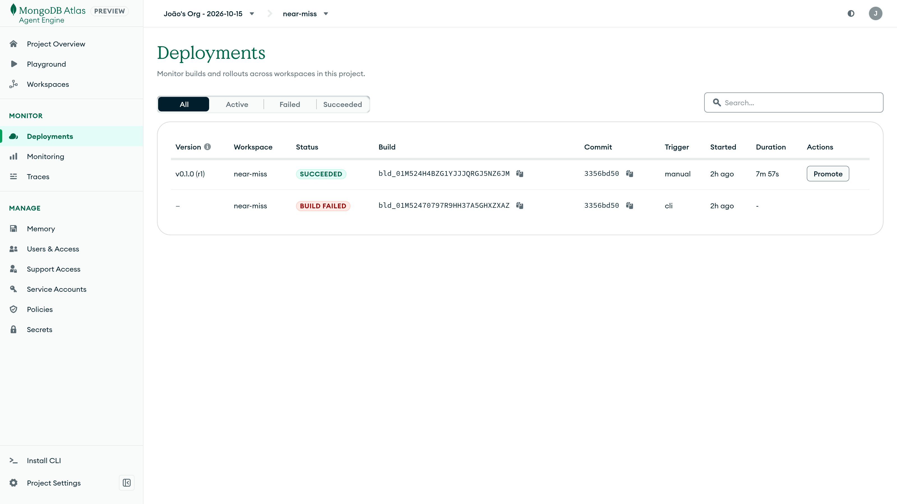 <!-- .element: style="max-height: 540px" -->

Note: The portal lists the first attempt as BUILD FAILED, then the pruned one as succeeded.

--

### The fix

<div class="flow auto">
<span style="--i:0"><span class="pill">✂️ Prune other OSes' natives</span></span><span style="--i:1"><span class="arrow">+</span><span class="pill">🔢 An int8 model</span></span><span style="--i:2"><span class="arrow">→</span><span class="pill good">✅ 34 MiB</span></span>
</div>

Note: A generic --prune option in the packager drops the other platforms' natives, and the jar goes to 7 MB. An int8 MiniLM is 23 MB instead of 86, with a different model id so its vectors are never compared with the float32 ones.

--

### Or ship no model at all

<div class="flow auto" style="font-size: 0.9em">
<span style="--i:0"><span class="pill bad">📦 ONNX jar + MiniLM in the package</span></span><span style="--i:1"><span class="arrow">→</span><span class="pill good">🚢 Voyage AI on Atlas</span></span>
</div>

<p class="filename">📄 .env</p>

```bash
NEAR_MISS_TEXT_PROVIDER=voyage
VOYAGE_API_KEY=…   # the one memory already uses
```

<p class="fragment">Problem #8 never happens.</p>

<p class="fragment small">Same key as memory. Nothing new to set up.</p>

Note: The suggestion from MongoDB, now a switch in the example: NEAR_MISS_TEXT_PROVIDER=voyage embeds with Voyage AI through Atlas (ai.mongodb.com, voyage-4 by default), records as documents and searches as queries. No ONNX Runtime, no model in the package. It reads VOYAGE_API_KEY, the project secret the memory server already needs, so there is nothing new to configure; the two share its rate limit. Vectors from different models are never compared, so switching means a fresh ingest into a new index (1024 dimensions instead of 384). Problem #2 still applies: a key with no payment method gets 3 requests a minute. Be honest: the transcripts in this talk ran MiniLM. The Voyage path has run for real against the EU endpoint: the live test passes and the full demo ran with it, next slides.

--

<!-- .slide: data-skippable="true" -->
### Pick a continent

<p class="small" style="margin: 0 0 0.4em">Atlas › Services › AI Model APIs › Model API Keys › Create</p>

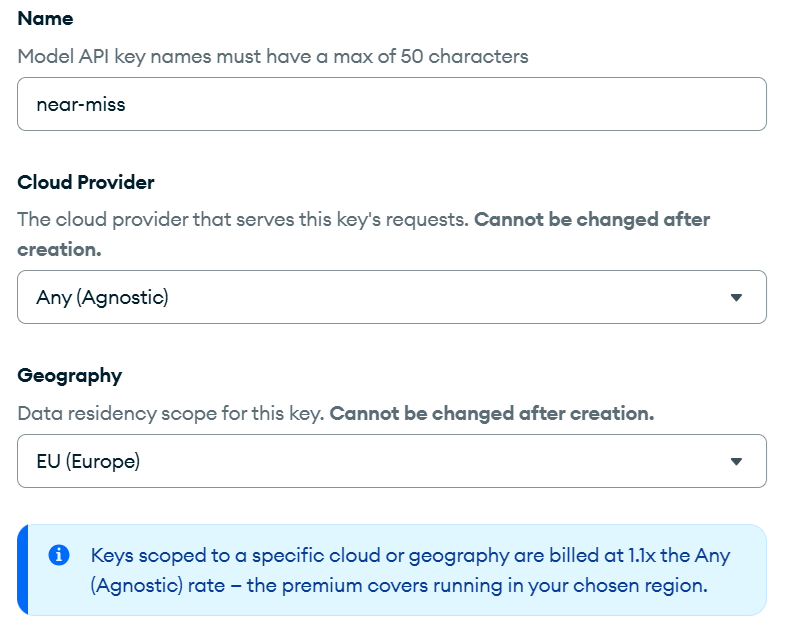

<p class="fragment small">Europe costs 1.1×. The key shows up once.</p>

Note: Atlas, AI Model APIs, Model API Keys, Create. The geography sets where the requests run and which host the key works on: EU keys only work on eu.ai.mongodb.com. Region-scoped keys need a paid tier, so add a payment method first, which also lifts the 3-requests-a-minute trial limit from Problem #2. The CLI and the Admin API only create Any/Any keys today, so a European key is a UI job. Copy it on the spot: it is shown once.

--

### Kick the tires

<p class="filename">🔑 is the key alive?</p>

```bash
curl https://eu.ai.mongodb.com/v1/embeddings \
  -H "Authorization: Bearer $VOYAGE_API_KEY" \
  -H "Content-Type: application/json" \
  -d '{"model": "voyage-4", "input_type": "query",
       "input": ["engine lost power during climb"]}'
```

<div class="fragment">

<p class="filename">☕ the same demo, embedded in Europe</p>

```bash
NEAR_MISS_TEXT_PROVIDER=voyage \
NEAR_MISS_VOYAGE_BASE_URL=https://eu.ai.mongodb.com/v1 \
mvn -pl examples/near-miss exec:java -Dexec.args=demo
```

</div>

Note: The commands as they ran on October 19. The curl returns a list with one 1024-number embedding (HTTP 200). The demo ingests 720 records, one Voyage call each, about 280 seconds, then runs the searches in memory; no Atlas cluster needed. The output says query_embedding voyage/voyage-4 at eu.ai.mongodb.com. Run from java/ with MAVEN_OPTS="-Xmx4g -XX:-UseSuperWord".

--

### Ask about a car, get a plane

<div class="chat">
<div class="bubble client l fragment fade-up" style="max-width: 100%">🧑 "car lost power while driving on the highway"</div>
<div class="bubble err r fragment fade-up">🧮 <strong>MiniLM</strong>, #1: "M-4, Takeoff: engine loss of power inflight" ✈️<small>a Maule</small></div>
<div class="bubble server r fragment fade-up">🚢 <strong>Voyage</strong>, #1: "Honda Accord 2018: blown head gasket" 🚗<small>three cars</small></div>
</div>

<p class="fragment" style="font-size: 0.9em">24 questions, no filter. MiniLM crossed domains on 3. Voyage on none.</p>

Note: A fair test, fixed before either run: 24 questions, 8 per domain (devices, vehicles, aviation), no kind filter, top 3, same 720 records. A hit counts when it comes from the right domain and mentions the topic (keywords chosen up front). Right domain in the top 3: MiniLM 0.94, Voyage 1.00. On topic: 0.89 vs 0.93. MRR: 0.93 vs 0.97. MiniLM mixed up cars and planes on "car lost power", "engine stalled at an intersection" and "aircraft stalled after takeoff"; Voyage never left the domain. Be fair: devices are a tie, and on aviation MiniLM is a touch better on topic. Small sample, keyword judge: a direction, not a benchmark. On the public RTEB retrieval leaderboard voyage-4 averages about 78 nDCG@10 and all-MiniLM-L6-v2 about 39.

--

### Problem #9: Network is unreachable

<div class="error">

```text
LLM stream failed: ConnectException: Network is unreachable
```

</div>

Note: The agent was up, the call to api.openai.com failed, and the egress policy listed api.openai.com:443 for both sandboxes. So it was not the allow-list.

--

<!-- .slide: data-skippable="true" -->
### Whose guess was right?

<div class="chat">
<div class="bubble client l fragment fade-up">🤖 <strong>Claude</strong>: "Force IPv4."<small><code>-Djava.net.preferIPv4Stack=true</code></small></div>
<div class="bubble server r fragment fade-up">🔬 <strong>A net probe</strong>: "IPv6 connects. IPv4: network is unreachable."<small>in both sandboxes</small></div>
<div class="bubble err r fragment fade-up">☕ <strong>Java</strong>: "I sort IPv4 first, and I try only the first address."<small>no happy eyeballs in <code>HttpClient</code></small></div>
</div>

<p class="fragment" style="font-size: 1.1em">The sandboxes are IPv6-only. My suggestion was backwards.</p>

Note: The suggested flag was exactly backwards. A small probe, switched on with an environment variable, logged what the sandbox could reach: no proxy variables, the AAAA addresses connect, the A addresses fail with errno 101.

--

### The fix

<span class="strike">`-Djava.net.preferIPv4Stack=true`</span> 🙃

`-Djava.net.preferIPv6Addresses=true` ✅

Note: Passed through JAVA_OPTS, which the shim reads. The call got past the network.

--

<!-- .slide: data-skippable="true" -->
### The log: Network is unreachable

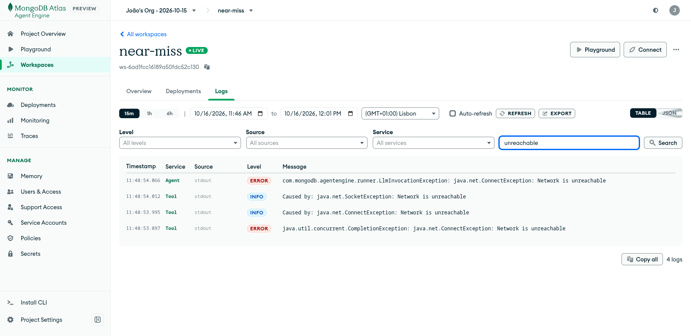 <!-- .element: style="max-height: 540px" -->

Note: The log line from the sandbox.

--

### Problem #10: The missing JRE module

<div class="error">

```text
Failed looking up TXT record for host …mongodb.net
```

</div>

Note: The call now reached the MongoDB driver, and failed resolving the cluster address.

--

<!-- .slide: data-skippable="true" -->
### Why?

<div class="chat">
<div class="bubble client l fragment fade-up">🍃 <strong>The MongoDB driver</strong>: "<code>mongodb+srv://</code>? I look up SRV and TXT records through JNDI."</div>
<div class="bubble err r fragment fade-up">☕ <strong>The JRE from pip</strong>: "I have N>>1 modules, but <code>jdk.naming.dns</code> isn't one of them."<small>a trimmed runtime</small></div>
</div>

Note: The MongoDB driver resolves SRV records through JNDI DNS. The pip-installed JRE is a jlinked runtime with 36 modules and no jdk.naming.dns.

--

### The fix

<div class="flow" style="font-size: 0.85em">
<span class="pill"><code>mongodb+srv://</code></span><span class="arrow">→</span><span class="pill bad">🔎 DNS lookup</span><span class="arrow">→</span><span class="pill">hosts + options</span>
</div>

<p class="filename">📄 the <code>MONGODB_URI</code> project secret</p>

```diff
-mongodb+srv://<user>:<password>@near-miss.….mongodb.net
+mongodb://<user>:<password>@ac-…-shard-00-00…:27017,
+   ac-…-shard-00-01…:27017,
+   ac-…-shard-00-02…:27017/?ssl=true&authSource=admin&replicaSet=…
```

<p class="fragment" style="font-size: 0.9em">The standard string names the hosts itself,<br> so the driver has nothing to look up.</p>

Note: A mongodb+srv address is short on purpose: the driver asks DNS for SRV records that list the hosts, and for a TXT record with the options. Without jdk.naming.dns it can't. The standard connection string, which Atlas also gives you for the cluster, has the three hosts and the options written out, so there is nothing to look up. We set it as the MONGODB_URI project secret. The proper fixes are a JRE that includes the module, roughly 15 to 20 MB more in the source archive, or a pure-Java DNS resolver plugged into the driver. Neither is done.

--

<!-- .slide: data-skippable="true" -->
### The log: TXT lookup fails

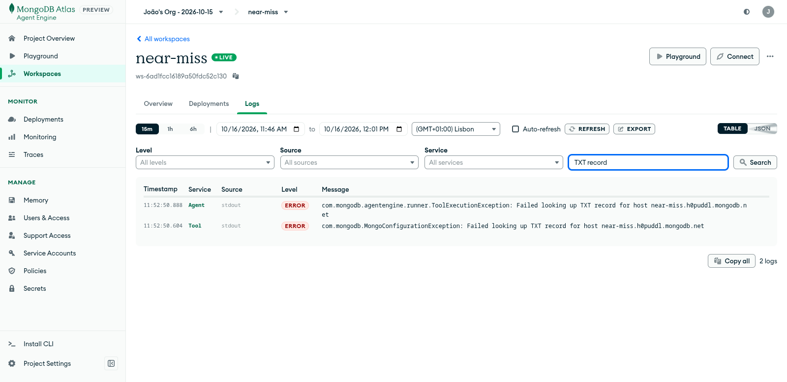 <!-- .element: style="max-height: 540px" -->

Note: The log line from the sandbox.

--

<!-- .slide: data-skippable="true" -->
### Problem #11: The model makes things up

<span class="small">This happened in an earlier demo that searched Netflix postmortems</span>

<div class="chat">
<div class="bubble client l fragment fade-up">🧑 "Find the Netflix Christmas Eve outage."</div>
<div class="bubble server r fragment fade-up">🤖 <strong>The model</strong> calls the search tool with a filter<small>one argument: which dataset to look in</small></div>
<div class="bubble err r fragment fade-up">🗄️ <strong>The tool</strong>: "0 hits."<small>nothing in the database matched that filter</small></div>
<div class="bubble err r fragment fade-up">🤖 "I found no records."<small>but the records were there</small></div>
</div>

Note: Two open-ended questions got no records while the data was there. Filtering by metadata worked, and so did the filtered search when told the exact arguments. Click for what the model put in the filter.

--

<!-- .slide: data-skippable="true" -->
### What did it put in the filter?

```text
the database has:   dataset_id = "netflix-public-postmortem"
the model sent:     dataset_id = "Netflix public postmortems"
```

<p class="fragment" style="font-size: 0.9em">It wrote the dataset's display name, but the filter wants the id, so nothing matched.</p>

Note: The tool schema said dataset_id was a string, nothing more. The model had seen the display name in the tool descriptions and the question, so it wrote that. An exact-match filter on a value that doesn't exist returns zero hits, and the model took zero hits as the answer.

--

<!-- .slide: data-skippable="true" -->
### The fix

<p style="font-size: 0.85em">The model never sees the code. It only sees each tool's schema: the arguments and what they accept.</p>

<p class="filename">📄 the <code>semantic_search</code> tool schema</p>

```diff
-"dataset_id", Map.of("type", "string"),
+"dataset_id", Map.of("type", "string", "enum", DATASET_IDS),
```

<p class="fragment" style="font-size: 0.9em">The schema now lists the valid dataset ids, <br>while a test checks the list.</p>

Note: The model never sees the Java. It sees a JSON schema for each tool, with the arguments and the values they accept. A bare string accepts anything, so the model filled the dataset filter with the display name it had read in the question. The fix lists the allowed ids as an enum, on both semantic_search and filter_metadata, so the model picks one of them. The diff is the real change from the repository, and a test now asserts the enum values.

---

<!-- .slide: data-background-color="var(--divider)" -->
## <span class="divider-title"><span class="chapter">Chapter 7</span>It's Alive!</span>

Note: 25:30. Section 7, about 3 and a half minutes. It works, and what it cost. Three questions for the deployed agent, then the lessons.

--

### And on the real platform?

<div class="chat">
<div class="bubble client l fragment fade-up">☕ <strong>Java runtime</strong>: "Hi. I'm <code>language=java</code>."<small>advertised to the managed Orchestration Engine</small></div>
<div class="bubble server r fragment fade-up">🧠 <strong>The managed OE</strong>: "…Sure. Come in."<small>the same answer as on my machine</small></div>
</div>

<div class="fragment">

```text
$ agentengine invoke "Hello from the managed platform"

Hello 6ad09241613deba73b039611, from a Java agent!

You said: Hello from the managed platform
```

</div>

<p class="fragment" style="font-size: 0.9em">Only the CLI's language check stood in the way.</p>

Note: The first full success on the managed platform, with the hello agent: all four agent replicas advertised language=java and the managed OE accepted it. The user id in the reply is the caller's platform user id. Nothing on the server side rejects Java; the only thing in the way was the CLI.

--

### Can it find things?

<div class="chat">
<div class="bubble client l fragment fade-up" style="max-width: 100%">🧑 "Find aviation reports about an engine losing power during climb."</div>
</div>

<div class="fragment">

```text
1. M-4, Takeoff: engine loss of power inflight    [ACN 2036402](https://asrs.arc.nasa.gov/docs/rpsts/fuel.pdf#page=43)

2. B737-700, Climb: engine failure during climb   [ACN 2081933](https://asrs.arc.nasa.gov/docs/rpsts/upsets.pdf#page=15)

3. A320, Initial Climb: uncommanded pitch up      [ACN 2032428](https://asrs.arc.nasa.gov/docs/rpsts/upsets.pdf#page=46)
```

</div>

Note: A Java agent on the managed platform, searching Atlas Vector Search. Real transcript from agentengine invoke, trimmed. Every hit carries its dataset id, source URL and licence. Search mode was atlas_vector_search. The ACN links open the NASA ASRS report set PDF at the page where the report starts. The last two are different reports from the same set.

--

### A Maule loses power at 300 feet

<div style="display: flex; gap: 0.8em; align-items: center; justify-content: center">
<div style="flex: 1"><a href="https://commons.wikimedia.org/wiki/File:Maule_M-4-210C_Rocket_C-FWZM_02.JPG" target="_blank" rel="noopener"></a><p style="font-size: 0.45em; margin: 0.2em 0">Maule M-4-210C Rocket, Ahunt, public domain</p></div>
<div style="flex: 1"><a href="https://asrs.arc.nasa.gov/docs/rpsts/fuel.pdf#page=43" target="_blank" rel="noopener">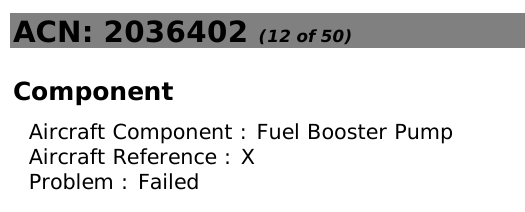</a></div>
</div>

<div class="chat">
<div class="bubble client l fragment fade-up" style="max-width: 100%; font-size: 0.55em">🧑‍✈️ <strong>The reporter</strong>: "The fuel pump that was supposed to be removed was in fact still on the plane and the cause of engine loss of power. I have attempted to reach out to seller but am unable to get in touch with him as I believe he is unavailable for next few weeks. Aviation safety at the core is about trust. Trust between pilot, mechanics, crew and all involved. I'm just a pilot, not a mechanic and I expect when a log book is signed airworthy and complied with all ADs and SBs for that to be true."<small>ASRS report <a href="https://asrs.arc.nasa.gov/docs/rpsts/fuel.pdf#page=43" style="color: inherit">ACN 2036402</a>, narrative</small></div>
</div>

<div class="chat" style="flex-direction: row; justify-content: flex-end; gap: 0.6em; margin-top: 0.3em">
<div class="bubble server r fragment fade-up" style="font-size: 0.55em; align-self: flex-start">📋 <strong>Primary problem</strong>: aircraft<small>Cause: according to the reporter</small></div>
<div class="bubble server r fragment fade-up" style="font-size: 0.55em; align-self: flex-start">📋 <strong>Contributing factors</strong>: aircraft</div>
</div>

Note: ACN 2036402. A Maule M-4 lost power on the takeoff climb at 300 to 500 ft, made an off-airport landing, and the plane flipped over with no injuries. Afterwards the pilot inspected the plane and found a fuel pump that an airworthiness directive said to remove (AD 2003-05-01) was still fitted. This is the one report of the three that names a cause, and it is the reporter's own conclusion. The picture is the aircraft type, from Wikimedia Commons, not from the report. The record image links to the PDF at that page.

--

<!-- .slide: data-skippable="true" -->
### A 737 loses an engine at 22,000 feet

<div style="display: flex; gap: 0.8em; align-items: center; justify-content: center">
<div style="flex: 1"><a href="https://commons.wikimedia.org/wiki/File:CFM56-7B_(4340708318).jpg" target="_blank" rel="noopener"></a><p style="font-size: 0.45em; margin: 0.2em 0">CFM56-7B, Kentaro Iemoto, CC BY-SA 2.0</p></div>
<div style="flex: 1"><a href="https://asrs.arc.nasa.gov/docs/rpsts/upsets.pdf#page=15" target="_blank" rel="noopener">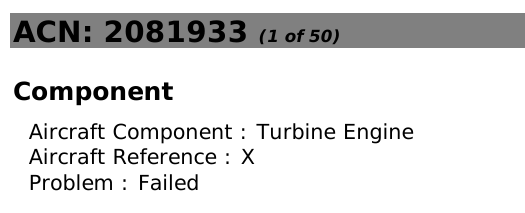</a></div>
</div>

<div class="chat">
<div class="bubble client l fragment fade-up" style="max-width: 100%; font-size: 0.55em">🧑‍✈️ <strong>The reporter</strong>: "Climbing through about 22,000ft, we heard a load thud accompanied by a sudden yaw. I was PF (Pilot Flying). The autopilot was on. The autopilot remained engaged. I shallowed the climb. We analyzed the situation and determined that the # 2 Engine had seized. […] We completed the Engine Failure Severe Damage QRC and then I transferred control to the FO, while I completed the checklists. I advised the Flight Attendants and asked if they saw or smelled anything unusual. They were aware that the engine had failed and described a large fireball that erupted briefly from the engine."</div>
</div>

<div class="chat" style="flex-direction: row; justify-content: flex-end; gap: 0.6em; margin-top: 0.3em">
<div class="bubble err r fragment fade-up" style="font-size: 0.55em; align-self: flex-start">📋 <strong>Primary problem</strong>: aircraft<small>Cause: not stated</small></div>
<div class="bubble err r fragment fade-up" style="font-size: 0.55em; align-self: flex-start">📋 <strong>Contributing factors</strong>: aircraft and procedure</div>
</div>

Note: ACN 2081933. At about 22,000 ft the crew heard a loud thud with a sudden yaw, determined that the number 2 engine had seized, and the cabin crew described a large fireball. They returned and landed. The report gives no cause for the seizure. The picture is the CFM56-7B, the 737-700 engine, from Wikimedia Commons, not from the report.

--

<!-- .slide: data-skippable="true" -->
### An A320 that wants to pitch up

<div style="display: flex; gap: 0.8em; align-items: center; justify-content: center">
<div style="flex: 1"><a href="https://commons.wikimedia.org/wiki/File:Airbus-H%C3%B6henruder.jpg" target="_blank" rel="noopener"></a><p style="font-size: 0.45em; margin: 0.2em 0">A320 stabilizer with elevators, AssetBurned, CC BY-SA 3.0</p></div>
<div style="flex: 1"><a href="https://asrs.arc.nasa.gov/docs/rpsts/upsets.pdf#page=46" target="_blank" rel="noopener">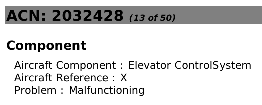</a></div>
</div>

<div class="chat">
<div class="bubble client l fragment fade-up" style="max-width: 100%; font-size: 0.55em">🧑‍✈️ <strong>The reporter</strong>: "I was the pilot flying and departed ZZZ Runway XXL. As I began climbing out, I noticed the aircraft required forward pressure on the side stick. Once I leveled off, and was level on the flight directors, the aircraft still required forward pressure to maintain level flight. The aircraft would constantly pitch up. […] We all agreed the safest course of action was a return to ZZZ. […] We also [requested priority handling] as we had some sort of issue with pitch trim in manual flight."</div>
</div>

<div class="chat" style="flex-direction: row; justify-content: flex-end; gap: 0.6em; margin-top: 0.3em">
<div class="bubble err r fragment fade-up" style="font-size: 0.55em; align-self: flex-start">📋 <strong>Primary problem</strong>: aircraft<small>Cause: not stated. The crew suspected a pitch trim issue</small></div>
<div class="bubble err r fragment fade-up" style="font-size: 0.55em; align-self: flex-start">📋 <strong>Contributing factors</strong>: aircraft and human factors</div>
</div>

Note: ACN 2032428. In the climb the aircraft needed forward pressure on the side stick to stay level. The crew called dispatch and maintenance, returned and landed, and the report says only that they had "some sort of issue with pitch trim in manual flight". No cause is given. The picture is an A320 horizontal stabilizer with its elevators, from Wikimedia Commons, not from the report. This is the point of "reports, not findings": the agent can say what the reporter wrote and never what caused it.

--

### Does it make things up?

<div class="chat">
<div class="bubble client l fragment fade-up" style="max-width: 100%">🧑 "Is there a verified connection between the pacemaker reports and the Tesla Model 3 complaints about sudden loss of power?"</div>
</div>

<div class="fragment">

```text
There is no verified connection. The FDA MAUDE and NHTSA
records do not share provenance, so they are not linked by
the same report or product.
```

</div>

Note: It refuses to make up a connection. Real transcript from agentengine invoke on the managed platform, trimmed.

--

### Does it give advice?

<div class="chat">
<div class="bubble client l fragment fade-up" style="max-width: 100%">🧑 "Is the Tandem Mobi insulin pump defective? Should I stop using mine?"</div>
</div>

<div class="fragment">

```text
One report (MW5176973) states that the original pump was confirmed 
defective by medical staff […]

For concerns about whether to continue using your pump, consult
the manufacturer, a clinician, or the agency that took the report.
```

</div>

Note: Real answer from the new build. The claim stays attributed to the report, and the advice question gets a referral. The first build did not do this; one prompt line fixed it.

--

<!-- .slide: data-skippable="true" -->
### The workspace is live

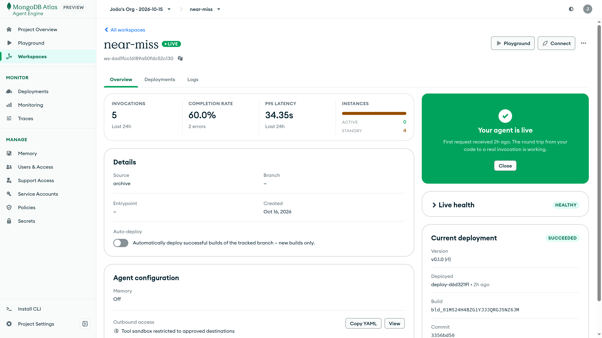

Note: The Agent Engine portal. The Near Miss workspace is live.

--

### The vector index is READY

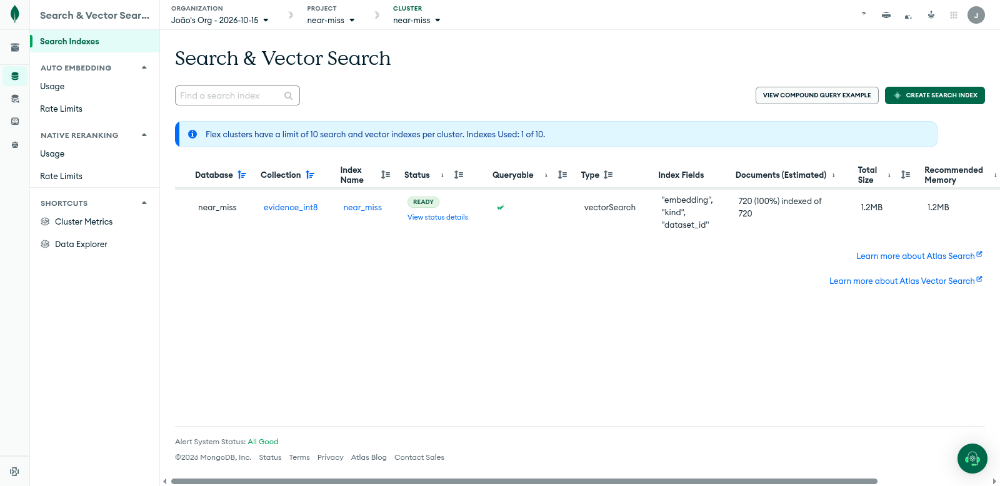

Note: The Atlas portal. The vector index on the safety reports is READY, with 720 documents.

--

### What we learned along the way

<ul style="font-size: 0.85em; list-style: none">
<li class="fragment" style="margin: 0.7em 0">🪵 <strong>Read the log before you theorize</strong> <span class="small">· Problem #2</span></li>
<li class="fragment" style="margin: 0.7em 0">🧪 <strong>Your fake server may be lying to you</strong> <span class="small">· Problem #1</span></li>
<li class="fragment" style="margin: 0.7em 0">🐍 <strong>Read the source when the docs are silent</strong> <span class="small">· Problem #7</span></li>
<li class="fragment" style="margin: 0.7em 0">🔬 <strong>Probe, don't guess</strong> <span class="small">· Problem #9</span></li>
<li class="fragment" style="margin: 0.7em 0">📝 <strong>Every workaround is a feature request</strong> <span class="small">· the next slide</span></li>
</ul>

Note: One line each, with the problem it came from. These are the five things that cost the most time, each with the problem it came from.

--

### 💌

<div class="letter" style="background: #FFFDF6; color: #2A2A2A; box-shadow: 0 6px 22px rgba(0,0,0,0.28); border-radius: 3px; padding: 1em 1.6em 0.9em; text-align: left; font-family: Georgia, 'Times New Roman', serif; font-size: 0.6em; line-height: 1.45; max-width: 860px; margin: 0 auto; text-wrap: pretty; transform: rotate(-0.5deg)">
<p style="margin: 0; text-align: right; font-size: 0.85em; color: #6B6B6B">16 October 2026</p>
<p style="margin: 0.4em 0 0.7em"><strong style="color: inherit">Dear MongoDB Atlas Agent Engine Team,</strong></p>
<p class="fragment" style="margin: 0.5em 0">I'm writing from the other side of a 404. I spent the past few days trying to get a Java agent running on Atlas Agent Engine, and I'm happy (and a little surprised) to report that it works. Your Orchestration Engine took one look at it, said "come in", and my agent picked up the call.</p>
<p class="fragment" style="margin: 0.5em 0">I should come clean about how. A small Python shim starts the JVM inside your Python runner, and the JRE ships as a PyPI wheel. Along the way I committed the ultimate sin: when the docs went quiet, I read your code. That's where I found the mutual TLS handshake, and a network probe showed me that the sandboxes only speak IPv6. It works, and I learned a lot, but one platform update could break it.</p>
<p class="fragment" style="margin: 0.5em 0">So here's a small request: let <code style="font-size: 0.9em">agentengine init</code> say <code style="font-size: 0.9em">java</code>. A Java runner image and a Maven build step would be wonderful, and a written-down runner contract would already be a gift. Or simply let us bring our own image. Any one of these would turn my stowaway into a paying passenger.</p>
<p class="fragment" style="margin: 0.5em 0">Thank you for building something worth sneaking into.</p>
<p class="fragment" style="margin: 0.8em 0 0">All the best,</p>
<p class="fragment" style="margin: 0; font-family: 'Caveat', 'Segoe Print', cursive; font-size: 2.2em; line-height: 1.1; color: #1F3A5F">João Galego</p>
<p class="fragment" style="margin: 0.3em 0 0; font-size: 0.85em; color: #6B6B6B">P.S. No hard feelings about <code style="font-size: 0.9em">java-none</code>.</p>
</div>

Note: The letter types itself at reading speed, about a minute in all; press → to finish a paragraph and jump to the next. Dear Platform Team. The shim works but is unsupported, and it could break with any platform update. This is the honest ending: here is what would make Java first-class. Init that accepts java, a Java runner base image with a Maven build step, the runner contract documented (mTLS and IPv6), or a way to bring your own image.

---

<!-- .slide: class="finale" -->
<div class="scratch">
<h1>Java vs. MongoDB<svg class="fragment scribble" data-fragment-index="0" viewBox="0 0 1000 120" preserveAspectRatio="none" aria-hidden="true"><path pathLength="1" d="M10 70 C 160 40, 260 95, 420 58 S 700 30, 990 62 M30 88 C 240 70, 520 96, 980 44"/></svg></h1>
<p class="fragment handwritten" data-fragment-index="1">Java + MongoDB</p>
</div>

Note: The title was a joke from the start: it was never a fight. Click to scratch it out, click again for the real title. A nod to João Mourão, who said the "vs." made it sound like a battle.

---

# Thanks! ☕

<div style="display: flex; gap: 1.4em; align-items: center; justify-content: center; margin-top: 0.6em">
<a href="https://github.com/JGalego/agent-engine-client-libraries/tree/feat/java-support" target="_blank" rel="noopener" style="display: block; background: #fff; padding: 10px; border-radius: 10px; width: 230px"></a>
<div style="text-align: left; font-size: 0.75em">
<p style="margin: 0.3em 0"><a href="https://github.com/JGalego/agent-engine-client-libraries" target="_blank" rel="noopener"><svg viewBox="0 0 24 24" width="1em" height="1em" style="vertical-align: -0.12em; margin-right: 0.35em" aria-hidden="true"><path fill="currentColor" d="M12 .297c-6.63 0-12 5.373-12 12 0 5.303 3.438 9.8 8.205 11.385.6.113.82-.258.82-.577 0-.285-.01-1.04-.015-2.04-3.338.724-4.042-1.61-4.042-1.61C4.422 18.07 3.633 17.7 3.633 17.7c-1.087-.744.084-.729.084-.729 1.205.084 1.838 1.236 1.838 1.236 1.07 1.835 2.809 1.305 3.495.998.108-.776.417-1.305.76-1.605-2.665-.3-5.466-1.332-5.466-5.93 0-1.31.465-2.38 1.235-3.22-.135-.303-.54-1.523.105-3.176 0 0 1.005-.322 3.3 1.23.96-.267 1.98-.399 3-.405 1.02.006 2.04.138 3 .405 2.28-1.552 3.285-1.23 3.285-1.23.645 1.653.24 2.873.12 3.176.765.84 1.23 1.91 1.23 3.22 0 4.61-2.805 5.625-5.475 5.92.42.36.81 1.096.81 2.22 0 1.606-.015 2.896-.015 3.286 0 .315.21.69.825.57C20.565 22.092 24 17.592 24 12.297c0-6.627-5.373-12-12-12"/></svg>JGalego/agent-engine-client-libraries</a></p>
<p style="margin: 0.3em 0"><svg viewBox="0 0 16 16" width="1em" height="1em" style="vertical-align: -0.12em; margin-right: 0.35em" aria-hidden="true"><path fill="currentColor" d="M9.5 3.25a2.25 2.25 0 1 1 3 2.122V6A2.5 2.5 0 0 1 10 8.5H6a1 1 0 0 0-1 1v1.128a2.251 2.251 0 1 1-1.5 0V5.372a2.25 2.25 0 1 1 1.5 0v1.836A2.5 2.5 0 0 1 6 7h4a1 1 0 0 0 1-1v-.628A2.25 2.25 0 0 1 9.5 3.25m-6 0a.75.75 0 1 0 1.5 0a.75.75 0 0 0-1.5 0m8.25-.75a.75.75 0 1 0 0 1.5a.75.75 0 0 0 0-1.5M4.25 12a.75.75 0 1 0 0 1.5a.75.75 0 0 0 0-1.5"/></svg><code>feat/java-support</code></p>
<p class="small" style="margin: 0.8em 0 0">Scan it, deploy it, tell me what breaks.</p>
</div>
</div>

Note: 29:30. Questions. The QR code opens the feat/java-support branch on GitHub.
