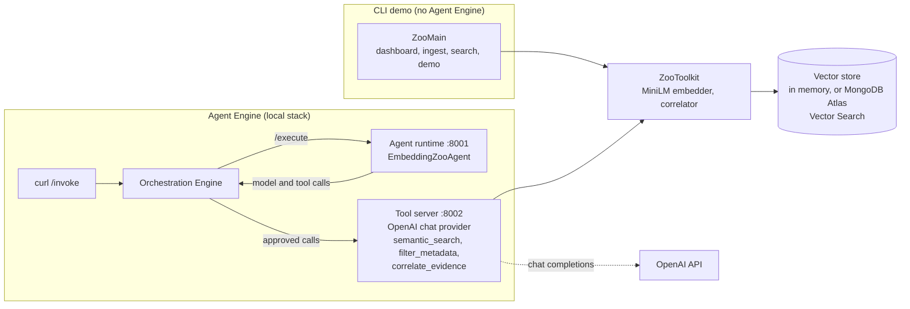
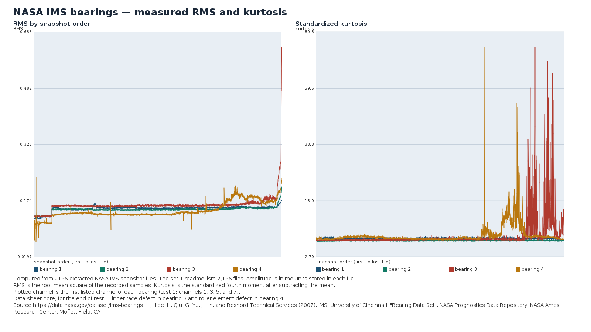

# Embedding Zoo

A Java agent that searches real public datasets with MongoDB Atlas Vector Search. The runnable
path is NASA IMS bearing telemetry, the Loghub `HDFS_2k` log sample, and public Netflix
Technology Blog postmortems. MVTec AD images are optional. Audio, video, and geospatial
collections are left for a later module.

Retrieval uses the SDK already in this repository: `RunnableApp`, `ToolDefinition`, `BaseAgent`,
and `SecureLlm`.

## Architecture

The CLI and the agent share the retrieval code. Only the agent runs on the Atlas Agent Engine.



| | CLI demo | Agent |
|---|---|---|
| Needs | JDK 17, Maven, the downloaded data | the local stack in Docker, `OPENAI_API_KEY` |
| Agent Engine | not used | the Orchestration Engine routes every model and tool call, and records it |
| Database | in memory, or Atlas with `MONGODB_URI` | the Atlas the tool server can reach; it only sees what `ingest` stored there |
| Where | any machine | the local stack only |

Atlas Vector Search is the database in both cases. It is not part of the Agent Engine. Java agents
run in the local stack for now, because the managed platform builds agent images from Python or
TypeScript sources.

## What the tools will and will not claim

`correlate_evidence` marks `verified_connection` only when two records share provenance stored at
ingest: the same snapshot, the same source document, or the same dataset. Cosine similarity
between records from different datasets is an analogous pattern in one embedding space. A shared
publisher name is a catalog attribution. Scores are reported with the model that produced them.
Vectors from different models are not compared.

## Licenses and setup

Dataset terms, citations, and what this repository does not redistribute are in
[`DATASETS.md`](DATASETS.md).

You need JDK 17, Maven, and about 8 GB of free disk. The IMS zip is about 1 GB and test 1 expands
to a few GB of snapshot files. On Linux x64 the demo downloads 7-Zip 26.02 (`7zz`) into `data/tools`
because junrar reports a CRC error before the last files of this solid RAR. 7-Zip is GNU LGPL with
its unRAR restriction; the license file is saved beside the binary and the binary is not committed.
`pdftotext` (Poppler) is optional; when it is on `PATH`, ingest records the shaft speed and radial
load printed in the archive readme.

```bash
cp .env.example .env
bash scripts/download-sources.sh
```

`download-sources.sh` fetches the MiniLM vocabulary and ONNX file, `HDFS_2k.log`, and the IMS zip.
It does not download MVTec AD.

## CLI demo

From `java/`:

```bash
export MAVEN_OPTS="-Xmx4g -XX:-UseSuperWord"
mvn -pl examples/embedding-zoo test
mvn -pl examples/embedding-zoo exec:java -Dexec.args=dashboard
mvn -pl examples/embedding-zoo exec:java -Dexec.args=demo
```

`scripts/demo.sh` runs the `demo` command with the same heap setting.

Some JDK 17 and 21 builds crash in the C2 compiler while vectorizing the feature loops (`hs_err`
file, `Type::typerr` or `TypeVect::xmeet`). If you hit it, add `-XX:-UseSuperWord` to `MAVEN_OPTS`.
`exec:java` does not compile, so run `mvn ... compile exec:java` after editing the code.

`dashboard` extracts IMS test 1. The archive readme lists 2,156 files for that set. The command plots every snapshot it extracted and writes:

- `dashboards/ims-rms-kurtosis.png`
- `dashboards/ims-waveform-spectrum.png`
- `dashboards/provenance.json`



The end of test 1 shows the documented failures: RMS and kurtosis climb on bearings 3 and 4.

Every plotted point is computed from those snapshot files. `provenance.json` records the file
hashes and the citation.

`demo` runs three retrievals in one process. With `MONGODB_URI` empty, the store is in memory and
is discarded when the process exits. The queries are:

- `bearing vibration with high kurtosis`
- `load balancer outage on Christmas Eve`
- correlate `packet responder terminating an HDFS block`

Text is embedded with `sentence-transformers/all-MiniLM-L6-v2` (`Xenova/all-MiniLM-L6-v2` ONNX,
mean pool, L2 normalize). Vibration uses `embedding-zoo/ims-vibration-features-v1` (12 classical
features). Image appearance, when MVTec files are present, uses
`embedding-zoo/rgb-histogram-4x4x4-v1`. A natural-language query searches the text space. Vibration
and histogram search take `like` set to a stored record id.

Ingest keeps a sample: 48 telemetry snapshots by default (first, last, extra tail, then an even
fill), all channels of each kept snapshot, and 400 of the 2,000 HDFS lines. The dashboard still
plots every extracted snapshot. Override the caps with `EMBEDDING_ZOO_MAX_SNAPSHOTS` and
`EMBEDDING_ZOO_MAX_LOG_LINES`.

Other commands: `download`, `ingest`, `search "<query>"`, `correlate "<query>"`, `accept-mvtec`.

## Atlas Vector Search

Set `MONGODB_URI` in `.env`. Ingest creates these cosine indexes on the collection
`embedding_zoo.evidence` (override with `MONGODB_DATABASE` and `MONGODB_COLLECTION`):

| Index | Field | Dimensions |
|---|---|---|
| `embedding_zoo_text` | `text_embedding` | 384 for MiniLM |
| `embedding_zoo_vibration` | `vibration_embedding` | 12 |
| `embedding_zoo_image` | `image_embedding` | 64 |

Each index also filters on `modality` and `dataset_id`. Each stored document keeps the embedding,
metadata, provenance, source URL, license, and model id.

If an index is not `READY`, search uses an exact cosine scan and the result says
`search_mode: exact_cosine`. That scan is not reported as Atlas Vector Search.

## MVTec AD

The dataset is CC BY-NC-SA 4.0 and is not downloaded by these scripts. Place the image folders in
`data/mvtec/images` using the published layout (`<category>/<train|test>/<label>/<file>`). Skip
`ground_truth`. Then:

```bash
mvn -pl examples/embedding-zoo exec:java -Dexec.args=accept-mvtec
```

The manifest records `placed_by_user=true` and `publisher_checksum_verified=false`. The histogram
is an appearance vector. It is not a CLIP embedding.

## Agent in the local stack

The chat agent needs an OpenAI API key. The CLI demo does not call the chat model.

Build the image, ingest into Atlas from the host, then point the local stack at this image. The
tool server reads Atlas and embeds queries with the MiniLM files, so mount `data/` at
`/opt/agent/data` and set `MONGODB_URI`.

```bash
mvn -f ../../pom.xml package -DskipTests -pl examples/embedding-zoo -am
docker build -t embedding-zoo:dev .
mvn -pl examples/embedding-zoo exec:java -Dexec.args=ingest
```

The local stack steps match [`assistant-agent`](../assistant-agent/README.md): scaffold a dev
stack, then replace the `app` service. Add the database and a data volume:

```yaml
services:
  app:
    image: embedding-zoo:dev
    build: !reset null
    working_dir: /opt/agent
    volumes: !override
      - /absolute/path/to/embedding-zoo/data:/opt/agent/data:ro
    environment:
      OPENAI_API_KEY: "${OPENAI_API_KEY:?set OPENAI_API_KEY}"
      MONGODB_URI: "${MONGODB_URI:?set MONGODB_URI}"
      EMBEDDING_ZOO_DATA: /opt/agent/data
```

Point the volume at this example's `data/` directory. `OPENAI_MODEL` selects the chat model
(default `gpt-4o-mini`). `EMBEDDING_ZOO_TEXT_PROVIDER=openai` uses `text-embedding-3-small`
instead of MiniLM; the Atlas text index dimension follows the model you ingest with.

```bash
curl -X POST http://localhost:3000/invoke -H 'Content-Type: application/json' \
  -d '{"message": "Find bearing snapshots with high kurtosis and say which dataset they come from.", "user_id": "ana"}'
```

To use the stack's own Atlas Local, ingest from the host through its mapped port
(`mongodb://localhost:<port>/?directConnection=true`, see `docker ps`) and give the `app` service
`mongodb://mongodb:27017/?directConnection=true`, since `localhost` inside the container is the
container itself.

## Managed platform

The packaging script in [`java/README.md`](../../README.md#deploy-to-the-managed-platform) wraps the
agent for the managed platform. This example's `platform.yaml` lists the three tools and allows
egress to `api.openai.com`; the model files ship in the package.

```bash
mvn package -DskipTests -pl examples/embedding-zoo -am        # from java/
../scripts/package-java-agent.sh examples/embedding-zoo \
  --include examples/embedding-zoo/data/models/minilm:data/models/minilm
cd examples/embedding-zoo/target/platform
agentengine init
agentengine atlas setup                                     # creates a billed Atlas cluster
agentengine secret set OPENAI_API_KEY
```

The tool sandbox searches the cluster `atlas setup` creates, so ingest into that cluster from your
machine first: allow your IP in Atlas, set `MONGODB_URI` to the URI `atlas setup` printed, and run
`ingest`. Then `agentengine deploy --auto` and `agentengine invoke "..."`.

The CLI demo keeps its in-memory store for that one process. Set `MONGODB_URI` before `ingest`
when the agent tool server should search the same records.
