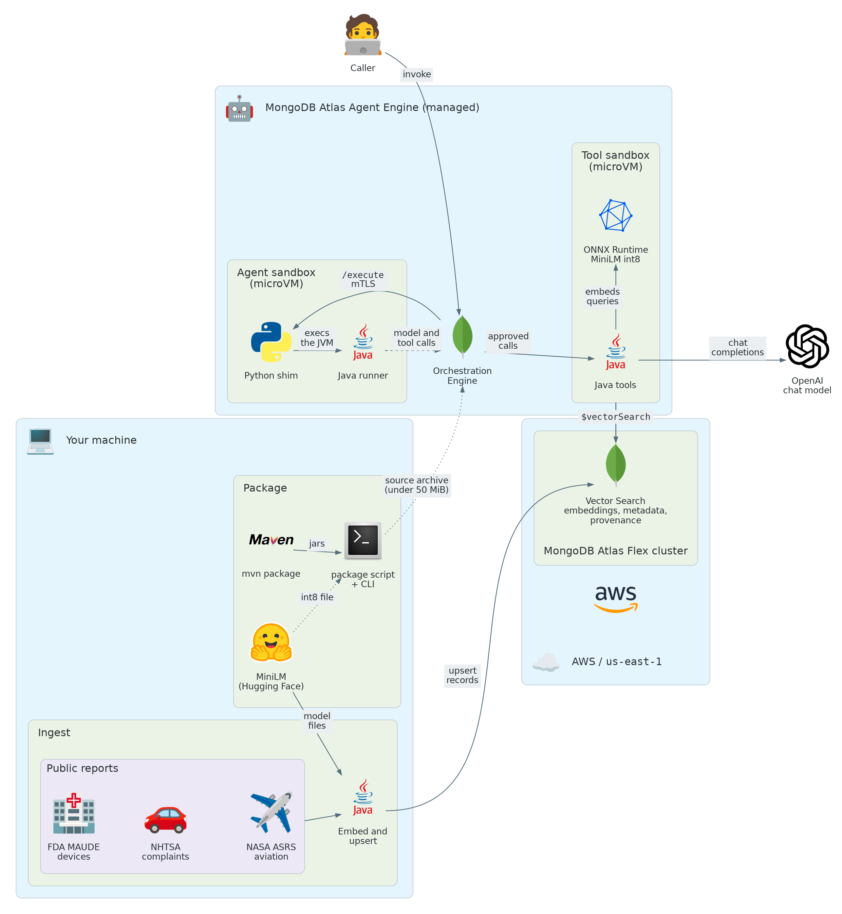

# Near Miss

A Java agent that searches public safety reports with MongoDB Atlas Vector Search: adverse event
reports for medical devices from the FDA's MAUDE database, vehicle complaints from NHTSA, and aviation
safety reports from NASA's ASRS. One model, MiniLM, embeds every record.

Retrieval uses the SDK already in this repository: `RunnableApp`, `ToolDefinition`, `BaseAgent`,
and `SecureLlm`.

## Architecture

The CLI and the agent share the retrieval code. Only the agent runs on the Atlas Agent Engine.



The diagram shows the managed deployment; the local stack has the same pieces as Docker containers.
It is code: `uv run docs/architecture.py` redraws it (needs Graphviz). Logos belong to
their owners; the script fetches the ones the `diagrams` package lacks from Simple Icons.

| | CLI demo | Agent |
|---|---|---|
| Needs | JDK 17, Maven, the downloaded data | the local stack in Docker, `OPENAI_API_KEY` |
| Agent Engine | not used | the Orchestration Engine routes every model and tool call, and records it |
| Database | in memory, or Atlas with `MONGODB_URI` | the Atlas the tool server can reach; it only sees what `ingest` stored there |
| Where | any machine | the local stack only |

Atlas Vector Search is the database in both cases. It is not part of the Agent Engine. Java agents
run in the local stack for now, because the managed platform builds agent images from Python or
TypeScript sources.

## What the tools will and will not claim

`correlate_evidence` marks `verified_connection` only when two records share provenance stored at
ingest: the same report, the same FDA product code, vehicle, aircraft or report set, or the same dataset. Even
then it says what is verified (a grouping in the source data) and not that the two reports describe
the same event. Cosine similarity between records from different datasets is an analogous pattern
in one embedding space. A shared publisher name is a catalog attribution. Scores are reported with
the model that produced them, and vectors from different models are not compared.

The reports are submissions, not findings. The agent is told never to say that a device, a vehicle or
an aircraft is defective, that it caused an outcome, or what anyone should do, and to point to the report instead.

## Licenses and setup

Dataset terms, citations, and what this repository does not redistribute are in
[`DATASETS.md`](DATASETS.md).

You need JDK 17, Maven and a few hundred MB of disk. There is no dataset to download: `ingest` reads
the reports from the openFDA and NHTSA APIs, which need no key at this volume (openFDA allows 240
requests a minute and 1,000 a day without one), and from six ASRS report-set PDFs. It caches the
responses and the PDFs under `data/cache`.

```bash
cp .env.example .env
bash scripts/download-sources.sh     # the MiniLM vocabulary and ONNX files
```

## CLI demo

From `java/`:

```bash
export MAVEN_OPTS="-Xmx4g -XX:-UseSuperWord"
mvn -pl examples/near-miss test
mvn -pl examples/near-miss exec:java -Dexec.args=demo
```

`scripts/demo.sh` runs the `demo` command with the same heap setting.

Some JDK 17 and 21 builds crash in the C2 compiler (`hs_err` file, `Type::typerr` or
`TypeVect::xmeet`). If you hit it, add `-XX:-UseSuperWord` to `MAVEN_OPTS`. `exec:java` does not
compile, so run `mvn ... compile exec:java` after editing the code.

`demo` ingests and then runs four retrievals in one process. With `MONGODB_URI` empty, the store is
in memory and is discarded when the process exits. The queries are:

- `insulin pump delivered too much insulin`
- `car lost power while driving on the highway`
- `engine lost power during climb`
- correlate `sudden loss of power with no warning`

Ingest keeps the most recent death and injury reports for eight kinds of device (infusion pumps,
insulin pumps, pacemakers, defibrillators, ventilators, hip implants, catheters and glucose
monitors), for six vehicles the complaints that mention a crash, fire, injury or death first, and
from six ASRS report sets (icing, fuel, cabin fumes, upsets, maintenance and GPS) the first reports
in each. `NEAR_MISS_RECORDS_PER_QUERY` (default 25) sets how many of each. Only the narrative
and the device, vehicle or aircraft fields are read. Patient details and VINs are not stored, and
ASRS reports are already de-identified.

Text is embedded with `sentence-transformers/all-MiniLM-L6-v2` (`Xenova/all-MiniLM-L6-v2` ONNX, mean
pool, L2 normalize). It reads 256 wordpieces, so a long narrative is cut into chunks of about 120
words and the stored text starts with the device, vehicle or aircraft. For MAUDE only the first chunk is
kept: later in a long narrative the manufacturer repeats boilerplate that would match every query.

Other commands: `download`, `ingest`, `search "<query>"`, `correlate "<query>"`.

## Atlas Vector Search

Set `MONGODB_URI` in `.env`. Ingest creates one cosine index, `near_miss`, on the field
`embedding` (384 dimensions for MiniLM) of the collection `near_miss.evidence`. Override the
names with `MONGODB_DATABASE` and `MONGODB_COLLECTION`.

The index also filters on `kind` (`device`, `vehicle` or `aviation`) and `dataset_id` (`fda-maude`,
`nhtsa-complaints` or `nasa-asrs`). Each stored document keeps the text, the embedding, metadata, provenance,
source URL, license, and model id.

If an index is not `READY`, search uses an exact cosine scan and the result says
`search_mode: exact_cosine`. That scan is not reported as Atlas Vector Search.

## Agent in the local stack

The chat agent needs an OpenAI API key. The CLI demo does not call the chat model.

Build the image, ingest into Atlas from the host, then point the local stack at this image. The
tool server reads Atlas and embeds queries with the MiniLM files, so mount `data/` at
`/opt/agent/data` and set `MONGODB_URI`.

```bash
mvn -f ../../pom.xml package -DskipTests -pl examples/near-miss -am
docker build -t near-miss:dev .
mvn -pl examples/near-miss exec:java -Dexec.args=ingest
```

The local stack steps match [`assistant-agent`](../assistant-agent/README.md): scaffold a dev
stack, then replace the `app` service. Add the database and a data volume:

```yaml
services:
  app:
    image: near-miss:dev
    build: !reset null
    working_dir: /opt/agent
    volumes: !override
      - /absolute/path/to/near-miss/data:/opt/agent/data:ro
    environment:
      OPENAI_API_KEY: "${OPENAI_API_KEY:?set OPENAI_API_KEY}"
      MONGODB_URI: "${MONGODB_URI:?set MONGODB_URI}"
      NEAR_MISS_DATA: /opt/agent/data
```

Point the volume at this example's `data/` directory. `OPENAI_MODEL` selects the chat model
(default `gpt-4o-mini`). `NEAR_MISS_TEXT_PROVIDER=openai` uses `text-embedding-3-small`
instead of MiniLM; the Atlas index dimension follows the model you ingest with.

`NEAR_MISS_TEXT_PROVIDER=voyage` embeds with Voyage AI through Atlas instead: no ONNX Runtime and no
model files are needed. It reads `VOYAGE_API_KEY`, the same project secret the memory server uses,
so one key covers both (and they share its rate limit). `NEAR_MISS_VOYAGE_MODEL` defaults to
`voyage-4` (1024 dimensions) and `NEAR_MISS_VOYAGE_BASE_URL` to `https://ai.mongodb.com/v1`, where
model API keys created in Atlas work. A key scoped to one region needs its own host, such as
`https://eu.ai.mongodb.com/v1`, and a key created on voyageai.com needs `https://api.voyageai.com/v1`. Records are embedded as documents and searches as
queries. Vectors from different models are never compared, so switching provider means a fresh
ingest into a new collection or index.

```bash
curl -X POST http://localhost:3000/invoke -H 'Content-Type: application/json' \
  -d '{"message": "Find reports of insulin pumps delivering the wrong dose and say which dataset they come from.", "user_id": "ana"}'
```

To use the stack's own Atlas Local, ingest from the host through its mapped port
(`mongodb://localhost:<port>/?directConnection=true`, see `docker ps`) and give the `app` service
`mongodb://mongodb:27017/?directConnection=true`, since `localhost` inside the container is the
container itself.

## Managed platform

The packaging script in [`java/README.md`](../../README.md#deploy-to-the-managed-platform) wraps the
agent for the managed platform. This example's `platform.yaml` lists the tools and allows egress to
`api.openai.com`. The platform accepts at most 50 MiB of source, so the package ships the int8 MiniLM
(23 MB, `NEAR_MISS_TEXT_PROVIDER=minilm-int8`, model id `...:int8`) and drops the ONNX runtime's
natives for other platforms. Its vectors differ slightly from the float32 model's, so ingest into a
separate collection and never mix the two.

```bash
cd java
mvn package -DskipTests -pl examples/near-miss -am
M=examples/near-miss/data/models/minilm
../scripts/package-java-agent.sh examples/near-miss \
  --include $M/vocab.txt:java/data/models/minilm/vocab.txt \
  --include $M/model_quantized.onnx:java/data/models/minilm/model_quantized.onnx \
  --prune 'onnxruntime-*.jar:ai/onnxruntime/native/win-*,ai/onnxruntime/native/osx-*,ai/onnxruntime/native/linux-aarch64/*'
cd examples/near-miss/target/platform
agentengine init
agentengine atlas setup                                     # creates a billed Atlas cluster
agentengine secret set OPENAI_API_KEY
agentengine secret set NEAR_MISS_TEXT_PROVIDER          # minilm-int8
agentengine secret set MONGODB_COLLECTION                   # evidence_int8
```

The tool sandbox searches the cluster `atlas setup` creates, so ingest into that cluster from your
machine first. Allow your IP in Atlas, then run `ingest` from `java/` with the same settings (and the
`MAVEN_OPTS` from the CLI demo section, or the JIT crash can hit):

```bash
export MAVEN_OPTS="-Xmx4g -XX:-UseSuperWord"
export MONGODB_URI='<the URI atlas setup printed>' NEAR_MISS_TEXT_PROVIDER=minilm-int8 MONGODB_COLLECTION=evidence_int8
mvn -pl examples/near-miss compile exec:java -Dexec.args=ingest
```

The `jdk4py` runtime the platform package uses has only 36 modules, and `jdk.naming.dns` is not one
of them, so the MongoDB driver cannot resolve `mongodb+srv://` URIs there. Give the sandbox the
cluster's standard URI instead (`atlas api flexClusters getFlexCluster ...` shows it under
`connectionStrings.standard`), with the database user's name and password added, as the
`MONGODB_URI` secret. Ingest from your machine can keep using the `+srv` form.

Also set `JAVA_OPTS=-Djava.net.preferIPv6Addresses=true`: the platform's sandboxes have only an IPv6
route, and the JDK tries IPv4 first.

Then `agentengine deploy --auto` and `agentengine invoke "..."`.

The CLI demo keeps its in-memory store for that one process. Set `MONGODB_URI` before `ingest`
when the agent tool server should search the same records.
